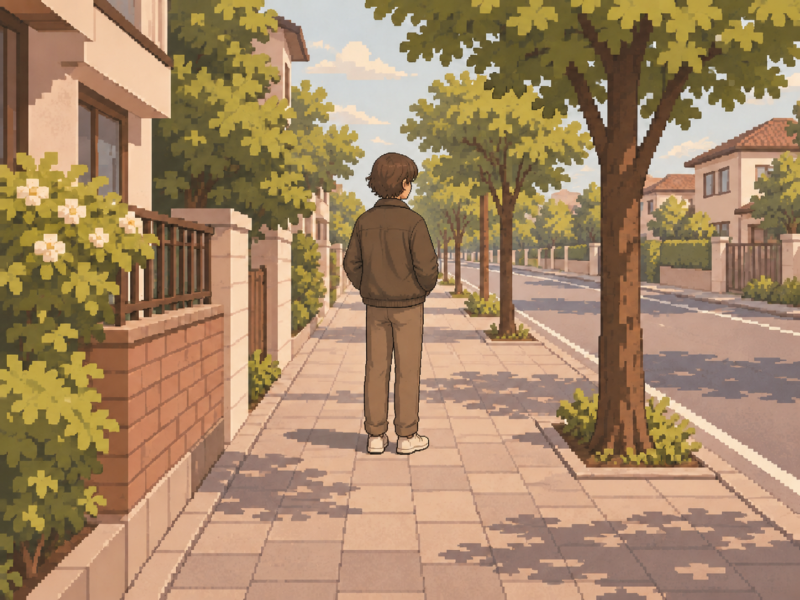
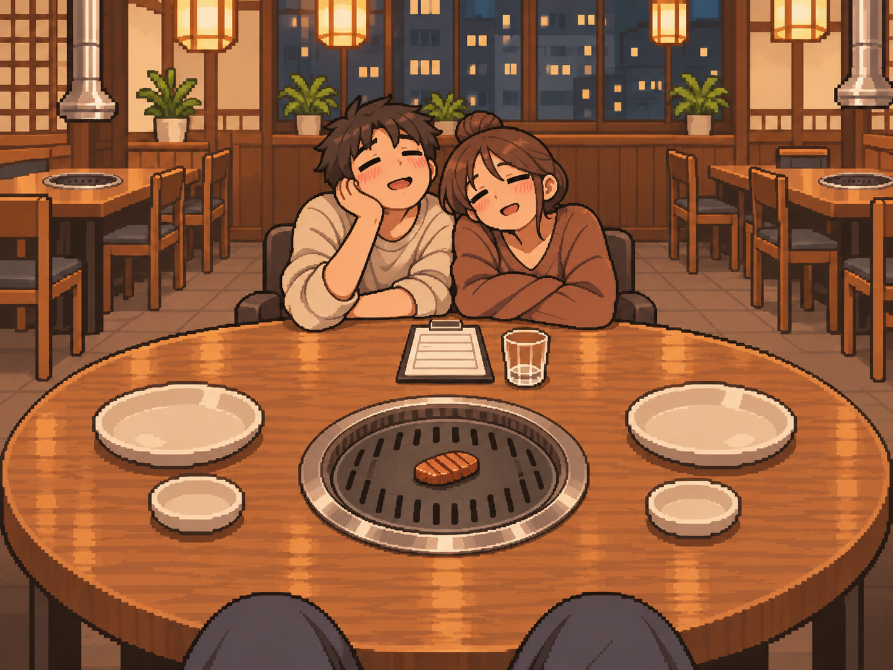
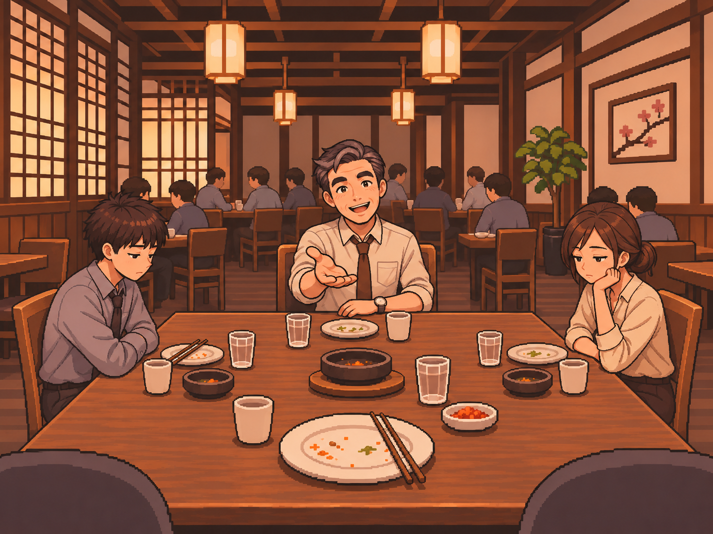

# 정원률 본 제작 1차 — 3장 검토 대기

2026-11-05 · 작업 브랜치 `feat/Week10/wonryul` · 기준 `9ec953d`

내장 image_gen으로 사건 3개의 PNG를 생성·보완하고 프로젝트에 저장했다.
모두 원본 1448×1086(4:3)을 유지했으며 리사이즈·코드 이미지 후처리를 하지 않았다.
프롬프트 전체, 완료한 수정 지시, 사건 본문·명세·지문, 파일 크기·SHA-256은 [manifest.json](manifest.json)에 있다.

| 사건 | 구도와 자체 검토 | 남은 검토 |
| --- | --- | --- |
| adult_005 이상형 발견 | 길 앞에 서 있는 상대를 1인칭에서 발견. 얼굴 묘사를 줄인 뒷모습, 중앙 전신·보도, 접근·연애 결과 없음 | 외형의 성별 중립성·본문 의미·실제 앱 크롭 |
| adult_010 고기 장인의 밤 | 취한 친구들, 불판의 마지막 고기 한 점, 무문자 계산서·잔을 중앙에 모음. 먹기·지불 이전 | 의미·화풍·실제 앱 크롭 |
| adult_020 2차는 노래방 | 팀장은 맞은편, 침묵하는 두 동료는 식탁 양옆의 별도 의자. 몸이 겹치지 않는 좌석 간격과 중앙 팀장의 권유 손짓 | 수정본 사용자 확인·의미·화풍·실제 앱 크롭 |

## 사용자 피드백 반영

2026-11-05: 사용자는 adult_005·adult_010의 그림 방향이 괜찮다고 답했다.
adult_020은 세 사람이 중앙에 몰려 무릎 위에 앉은 것처럼 보인다는 의견을 받아 내장 image_gen으로 다시 편집했다.
팀장·직원의 몸이 겹치지 않도록 각자 별도 의자에 앉히고 식탁을 사이에 둔 자연스러운 간격을 확보했다.
이 그림은 세로 크롭에서 팀장 얼굴·권유 손짓·식탁을 우선한다. 양옆 동료 일부 또는 전부가 잘릴 수 있다.
세 사람 전체를 중앙에 넣기 위해 좌석을 다시 밀집시키지 않는다.
사용자 그림 방향 확인은 팀 의미 검토나 실제 기기 검수 승인으로 기록하지 않았다.
좌석 간격 수정본도 사용자가 확인했다. 첫 묶음 3장 모두 그림 방향 확인을 받았으며 팀·기기 검수는 대기다.

## 그림

### adult_005

### adult_010

### adult_020

## 앱에서 확인

빌드 후 홈 → 디자인 미리보기 → 장면 고르기 → **15~17번**.
검토용 목록은 실제 저장한 PNG를 읽는다. 원본 필름과 장면 보기의 세로 중앙 크롭을 대조한다.
중앙 사건 라우팅·카탈로그와 승인 manifest는 변경하지 않았다.

## 상태와 수량

- 제작대장 3행을 `PNG_PRODUCED_PENDING_REVIEW`로 기록했다. 승인으로 처리하지 않았다.
- 본인 할당 69그룹: 기존 승인 4 + 이번 PNG 검토 대기 3 + 아직 미제작 62.
- 미승인 잔량은 여전히 65그룹이다. 타 담당자 보완 4장은 본인 할당에서 차감하지 않는다.
- 자체 검토는 원본과 중앙 x=34~66% 대역 기준이다. 팀 독립 검토·실제 기기 검수를 대신하지 않는다.
- ADB 연결 실패로 실제 앱 실행·화면 캡처는 미확인이다.
