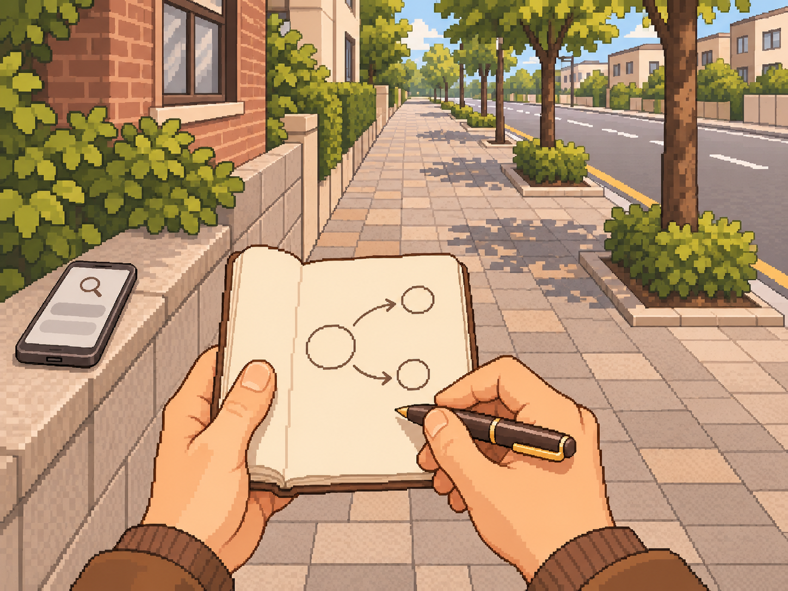
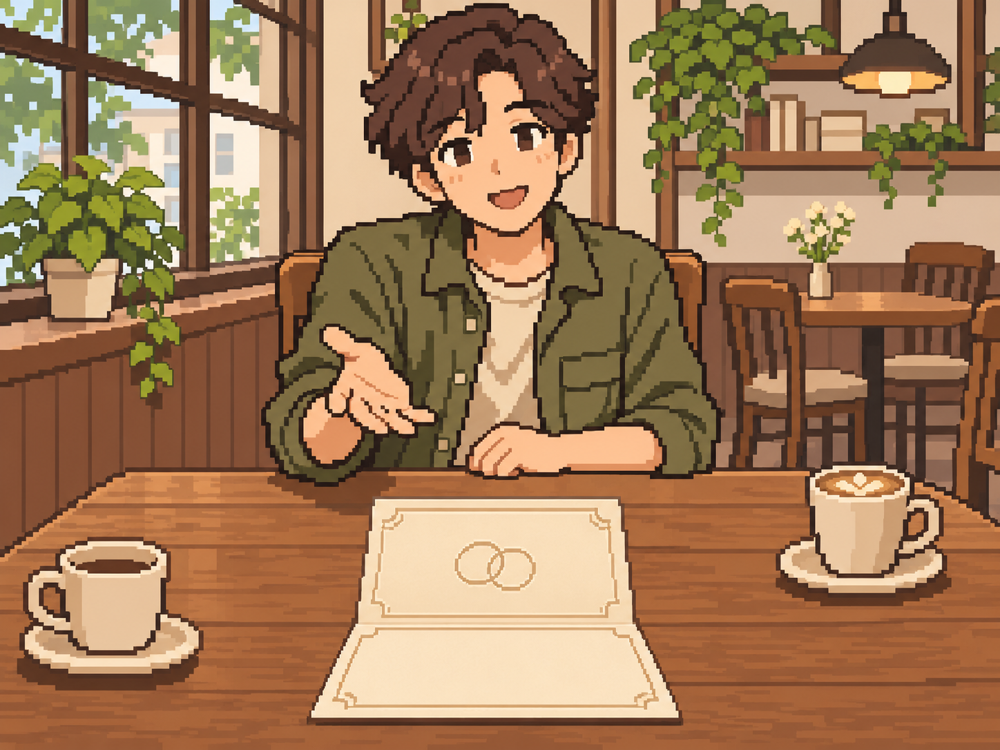
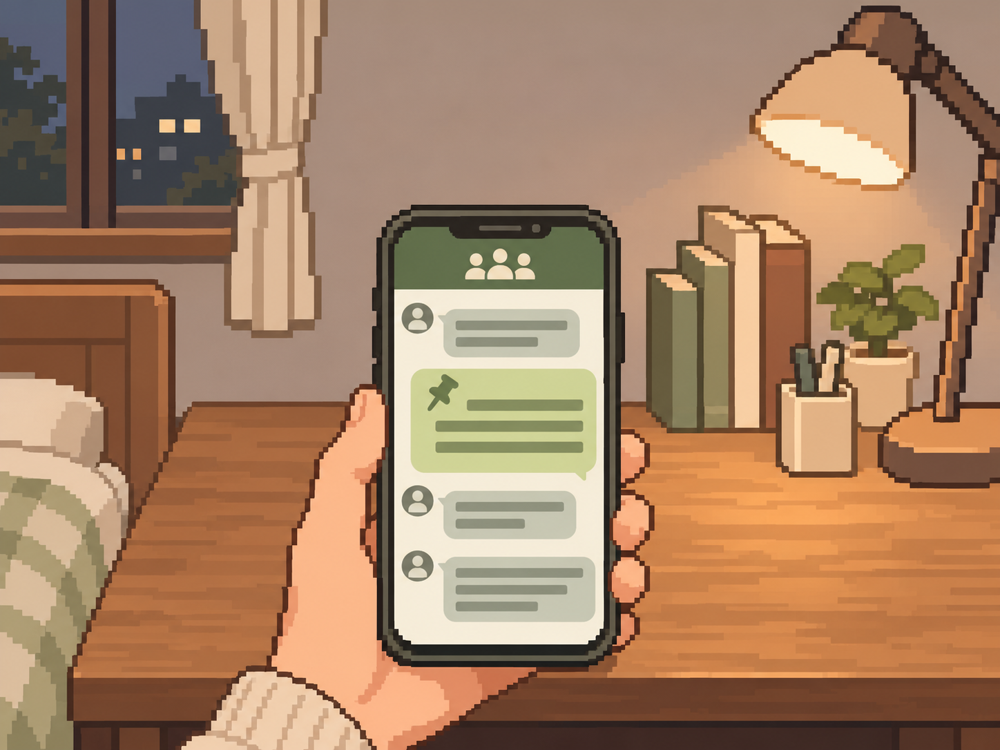

# 정원률 본 제작 2차 — 3장 검토 대기

사용자 확인: 2026-11-05 세 장 모두 합격. 그림 방향 확인이며 팀 의미·실제 기기 검수 승인은 별도다.

2026-11-05 · `feat/Week10/wonryul` · 기준 `9ec953d`

내장 image_gen으로 아래 세 장을 각각 생성했다. 원본 1448×1086(4:3) PNG를 프로젝트에 복사했으며 리사이즈·코드 이미지 후처리는 하지 않았다.
생성 프롬프트 전체, 사건 본문·명세·지문, 파일 크기·SHA-256, 검토 상태는 [manifest.json](manifest.json)에 있다.
첫 묶음의 PNG 3장은 해시가 동일함을 확인했다.

| 사건 | 구도와 자체 검토 | 남은 확인 |
| --- | --- | --- |
| adult_025 특허가 될지도 모르는 아이디어 | 걷던 길에서 메모장·펜으로 아이디어를 기록. 개념도는 원·화살표뿐이며 특허증·수상·등록 결과 없음. 담장의 휴대폰은 자료 확인 수단의 연출 | 사용자 그림 방향·의미·화풍·실제 앱 크롭 |
| adult_030 베프의 결혼식 | 카페에서 친구의 축사 부탁을 듣는 순간. 무문자 청첩장과 자연스러운 식탁 간격. 결혼식장·축사 수행·수락 결과 없음 | 사용자 그림 방향·의미·화풍·실제 앱 크롭 |
| adult_035 10년 만의 동창회 | 집 책상에서 휴대폰의 단체 대화 공지를 확인. 그룹 아이콘·공지 핀·메시지 블록, 이름·날짜·답장·실제 모임 없음 | 사용자 그림 방향·의미·화풍·실제 앱 크롭 |

## 그림

### adult_025

### adult_030

### adult_035

## 검토용 미리보기

빌드 후 홈 → 디자인 미리보기 → 장면 고르기 → **18~20번**.
원본 필름과 장면 보기의 세로 중앙 크롭을 대조한다.
원본의 자연스러운 구도와 핵심 사물을 우선한다. adult_025의 측면 검색용 휴대폰과 adult_030의 측면 커피잔 등은 세로 크롭에서 제외될 수 있다.
실제 앱 실행·기기 캡처는 미확인이다. 기존 ADB 연결 실패 상태를 해소했다고 기록하지 않았다.
중앙 사건 라우팅·카탈로그·승인 manifest는 변경하지 않았다.

## 수량

본인 할당 69그룹 = 기존 승인 4 + 첫 묶음 검토 대기 3 + 이번 묶음 검토 대기 3 + 아직 미제작 **59**.
미승인 잔량은 65그룹이며 신규 PNG 6장은 완성 승인 장수와 구분한다.
이번 제작대장 3행은 `PNG_PRODUCED_PENDING_REVIEW`로 기록했다.
자체 시각 검토를 사용자 확인·팀 독립 검토·실제 기기 검수로 표시하지 않았다.
