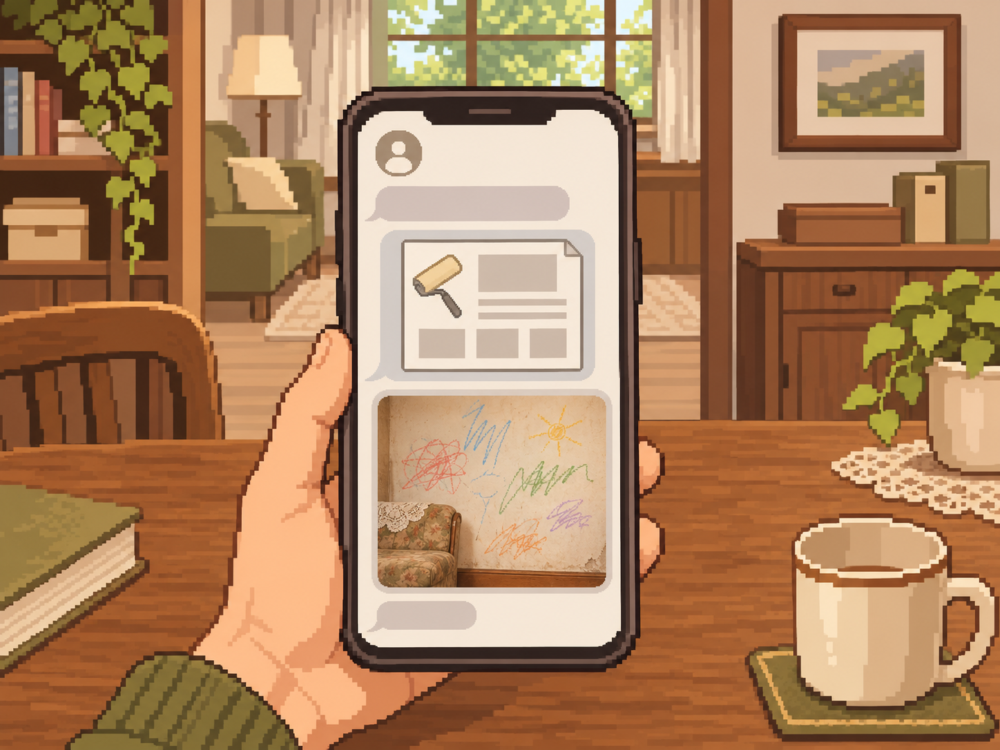
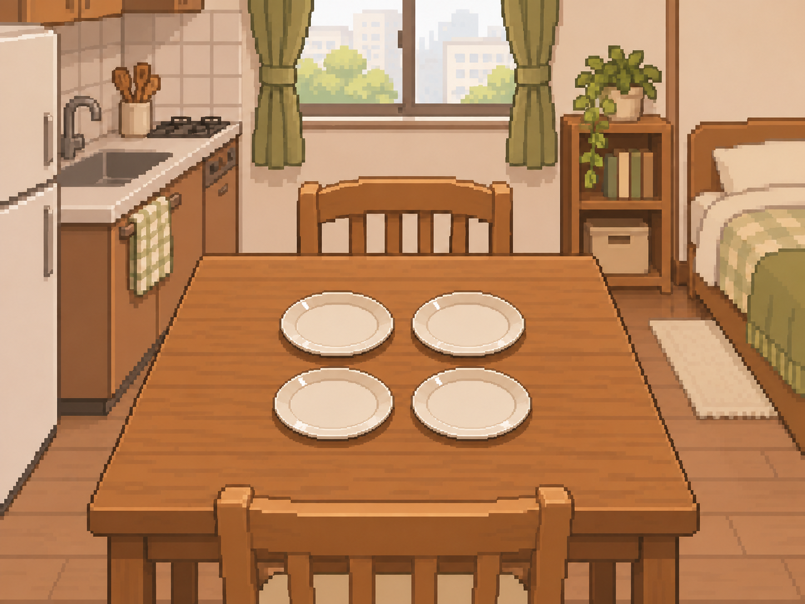
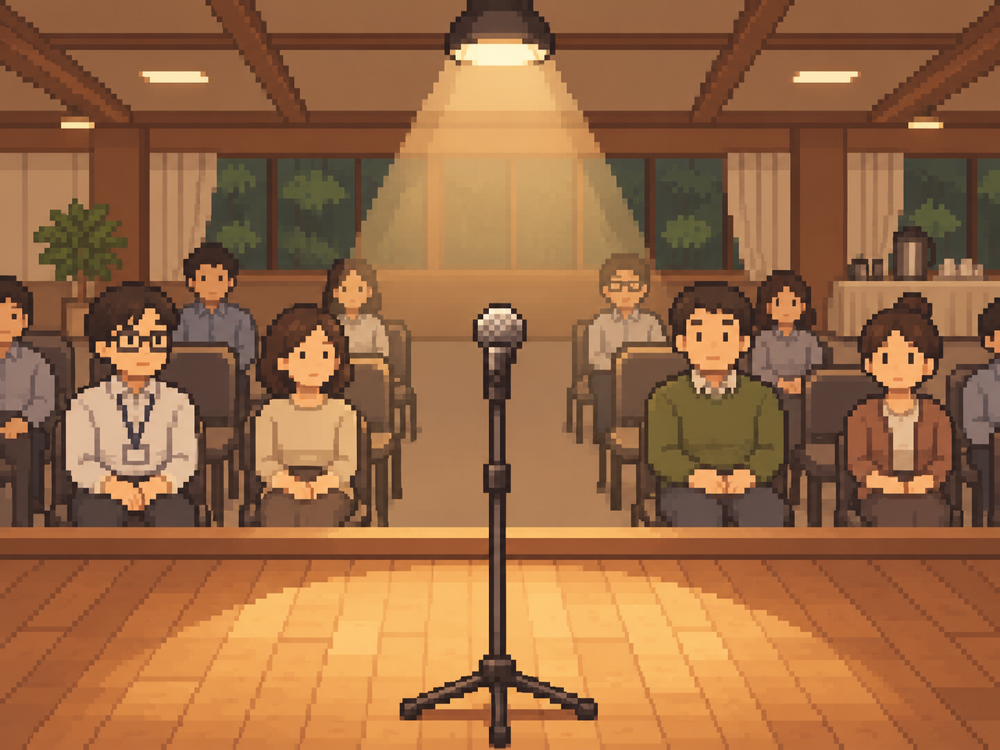
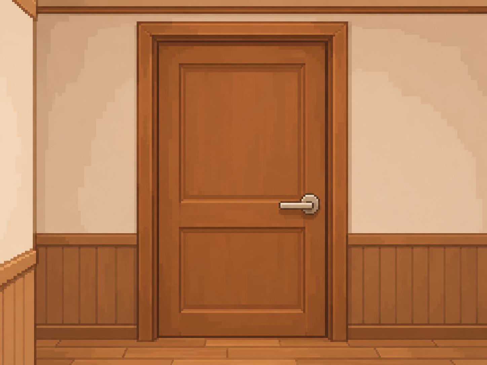
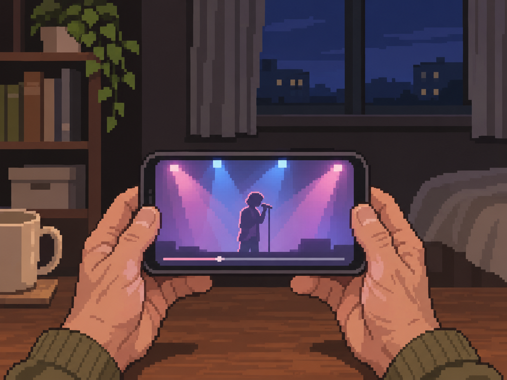

# 정원률 본 제작 3차 — 5장 검토 대기

사용자 확인: 2026-11-05 다섯 장에 ㅇㅋ라고 응답하고 다음 제작을 요청했다. 그림 방향 확인이며 팀·실제 기기 검수 승인은 별도다.

2026-11-05 · `feat/Week10/wonryul` · 기준 `9ec953d`

사용자가 두 번째 묶음을 합격으로 확인하고 이후 5~10장 단위 검토를 요청했다. 이번부터 기본 5장씩 제작한다.
내장 image_gen으로 별도 PNG 5장을 생성하고 집들이의 접시 배치를 추가 보완했다.
원본 1448×1086(4:3)을 보존했으며 리사이즈·코드 이미지 후처리는 하지 않았다.
[전체 프롬프트·사건 명세·파일 정보](manifest.json) · [파일 검사 결과](validation.json).

| 사건 | 자체 시각 검토 |
| --- | --- |
| adult_040 30년 만의 의뢰 | 휴대폰의 공모 자료와 과거 거실 벽 낙서 사진. 선정·완성 벽화 없음 |
| adult_045 첫 집들이 | 손님 도착 전 빈 자취방. 서로 겹치지 않는 접시 정확히 네 개를 중앙에 배치 |
| adult_050 워크숍 장기자랑 | 무대 위 1인칭, 마이크·조명·무대 끝과 기다리는 객석. 공연 결과 없음 |
| adult_055 닫힌 방문 | 부모 시점의 닫힌 문·손잡이. 아이 얼굴·성별·방 내부·문 열기 없음 |
| adult_060 늦게 배운 덕질 | 새벽 집에서 휴대폰 속 가상 가수의 무대 영상 시청. 실존 인물·플랫폼·횟수 글자 없음 |

## 그림

### adult_040 — 30년 만의 의뢰

### adult_045 — 첫 집들이

### adult_050 — 워크숍 장기자랑

### adult_055 — 닫힌 방문

### adult_060 — 늦게 배운 덕질

## 검토와 수량

- 빌드 후 홈 → 디자인 미리보기 → 장면 고르기 → **21~25번**에서 검토한다.
- 첫 두 묶음 6장은 사용자 그림 방향 확인을 받았다. 해당 파일들의 해시는 유지했다.
- 이번 5장은 사용자 확인·팀 의미/시각 검토·실제 기기 크롭 검수 대기다. 원본 자체 시각 검토를 실제 앱 검수로 표시하지 않는다.
- 중앙 라우팅·카탈로그·승인 manifest는 유지했다. 기기 검수는 이전 ADB 연결 실패 이후 미실행이다.
- 할당 69그룹 = 기존 승인 4 + 새 PNG 검토 대기 11 + 아직 미제작 **54**.
- 미승인 잔량은 65그룹이다. 사용자 그림 확인은 중앙 최종 인수와 구분한다.
