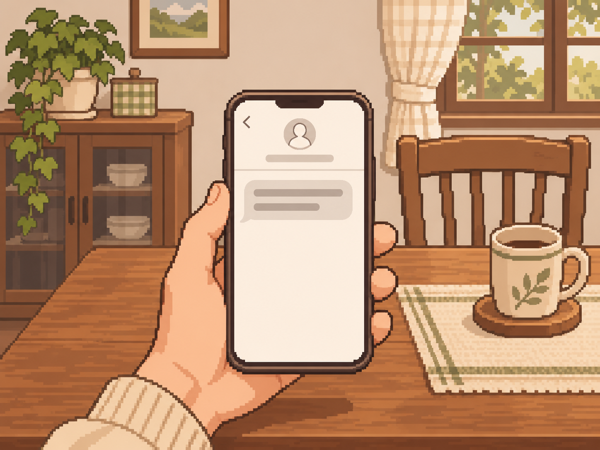

# 정원률 본 제작 4차 — 5장 검토 대기

사용자 확인: 2026-11-05 다섯 장 모두 합격, 다음부터 10장 단위 진행 요청. 그림 방향 확인이며 팀·실제 기기 검수 승인은 별도다.

2026-11-05 · `feat/Week10/wonryul` · 기준 `9ec953d`

내장 image_gen으로 각 사건별 PNG 5장을 생성하고 원본 1448×1086(4:3)을 그대로 저장했다.
리사이즈·코드 이미지 후처리는 하지 않았다. [전체 프롬프트·사건 명세·파일 정보](manifest.json) · [파일 검사](validation.json).

| 사건 | 자체 시각 검토 |
| --- | --- |
| adult_065 쉰 번째 생일 | 긴 초 정확히 다섯 개. 소원 전 상태, 가족 얼굴·관계·성별·연령을 특정하지 않는 측면 표현 |
| adult_072 서른의 첫 명함 | 집 책상의 입사 제안서와 시험 접수증을 가방·연필 도형으로 구분. 명함·채용 수락 없음 |
| adult_077 첫사랑의 연락 | 미등록 발신자 아이콘과 단일 수신 메시지. 고교 회상·재회·답장·연애 결과 없음 |
| adult_082 나보다 어린 사수 | 직장 책상 너머 성인 사수의 어색한 표정과 소개 손짓. 자연스러운 거리 |
| child_005 받아쓰기 전날 | 집의 빈 줄 공책·연필과 방 건너 켜진 만화 TV. 시험 당일·성적·선택 결과 없음 |

## 그림

### adult_065 — 쉰 번째 생일

### adult_072 — 서른의 첫 명함

### adult_077 — 첫사랑의 연락

### adult_082 — 나보다 어린 사수

### child_005 — 받아쓰기 전날

## 검토와 수량

- 빌드 후 홈 → 디자인 미리보기 → 장면 고르기 → **26~30번**에서 확인한다.
- 앞선 세 묶음 11장은 사용자 그림 방향 확인을 받았고 파일 해시도 유지했다.
- 이번 5장은 사용자 확인·팀 의미/화풍·실제 앱 크롭 검수 대기다.
- 자연스러운 원본과 핵심 사물 우선. adult_072는 세로 화면에서 종이 외곽 일부가 잘릴 수 있으며 두 진로 구분 단서를 확인해야 한다.
- 실제 기기 검수는 이전 ADB 연결 실패 이후 미실행이다. 중앙 사건 라우팅·카탈로그·승인 manifest는 유지했다.
- 본인 할당 69 = 기존 승인 4 + 새 PNG 검토 대기 16 + 미제작 **49**.
- 미승인 잔량 65그룹. 사용자 그림 확인과 팀 최종 인수 승인은 구분한다.
