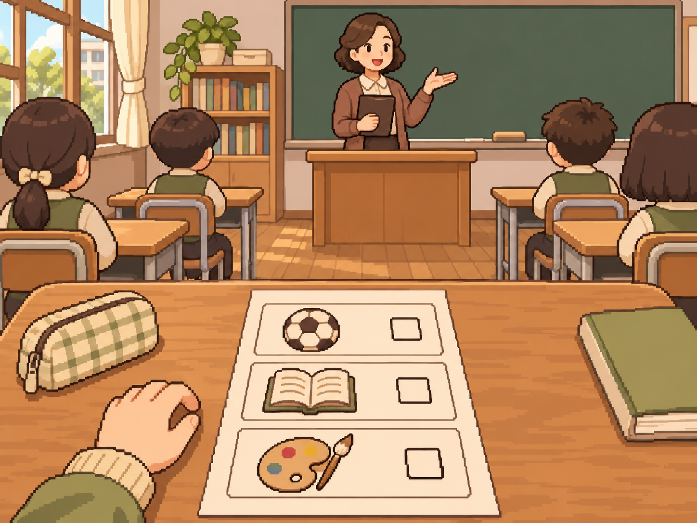
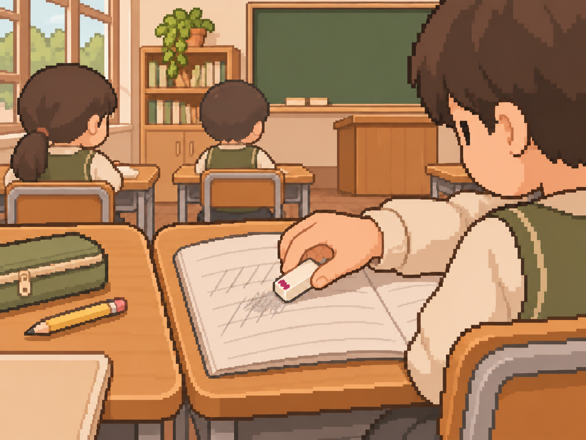
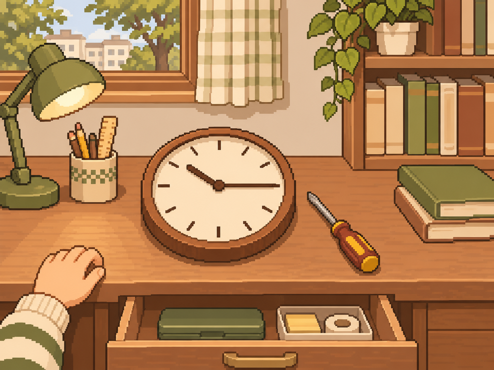
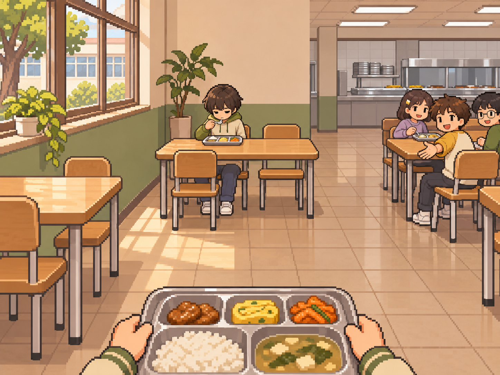
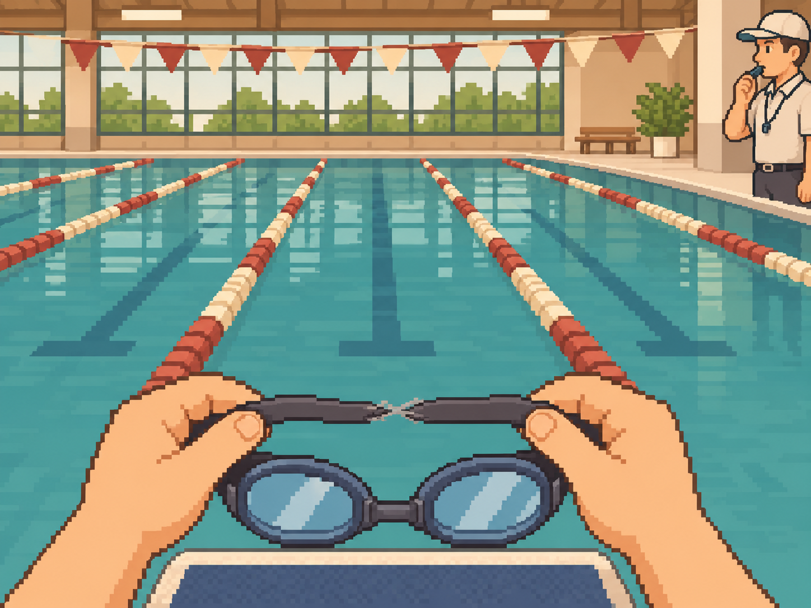
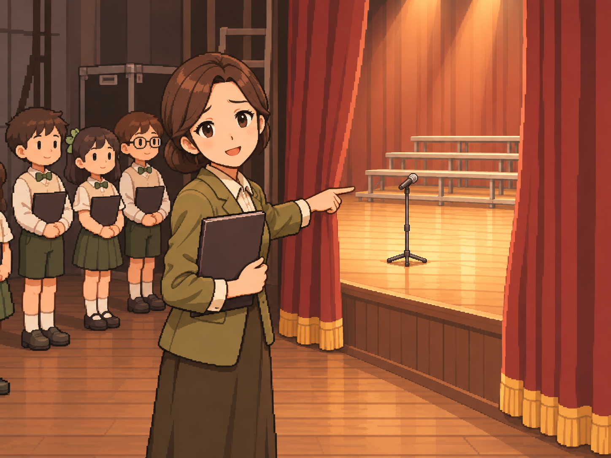
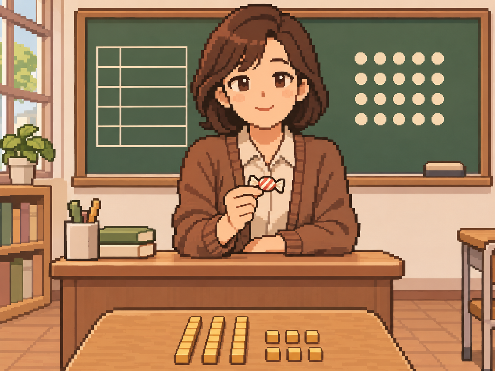
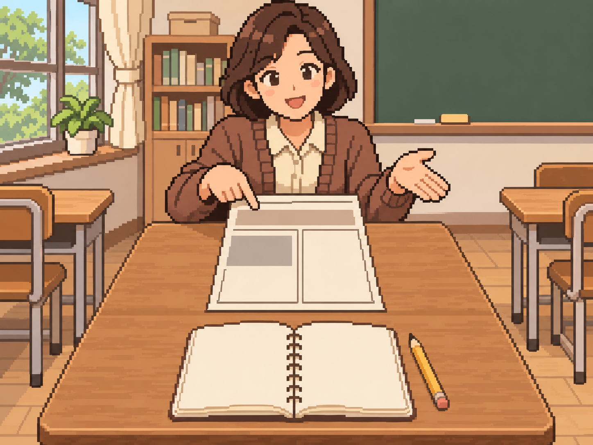

# 정원률 본 제작 5차 — 10장 검토 대기

최신 사용자 확인: 2026-11-05 무대 마이크·교사 손짓을 수정한 child_035도 확인 후 합격. 이 묶음 10장 모두 사용자 그림 방향 확인 완료이며 팀·실제 기기 검수는 별도다.

사용자 확인: 2026-11-05 child_035를 제외한 9장은 그림 방향 확인 완료.
child_035는 사용자의 추가 지적에 따라 마이크 위치와 교사 손짓을 수정했다. 교사는 대기 공간에서 무대 쪽을 가리키며 부탁하고, 마이크 한 대는 열린 커튼 너머 조명이 켜진 공연 무대 바닥에 놓였다.
기존 답변은 준비 공간이라는 맥락만 판단해 마이크 위치의 부자연스러움을 놓쳤다. 수정 전 해시·판단과 사용자 수정 지시는 manifest의 revisionHistory에 보존했다.
수정본은 사용자 확인을 받았으며, 솔로를 수락하거나 공연하기 전 시점을 유지한다.

2026-11-05 · feat/Week10/wonryul · 기준 9ec953d

사용자 요청으로 이번부터 10장 단위로 제작·검토한다. 앞선 16장은 사용자 그림 방향 확인 완료다.
내장 image_gen으로 사건별 PNG 10장을 별도 생성했고, 지우개 모서리의 글자처럼 보이는 표시를 무문자 얼룩으로 보완했다.
원본 1448×1086(4:3)을 그대로 저장했으며 리사이즈·코드 이미지 후처리는 하지 않았다.
[전체 프롬프트·사건 명세·파일 정보](manifest.json) · [파일 검사 결과](validation.json).

| 사건 | 자체 시각 검토 |
| --- | --- |
| child_010 동아리 신청서 | 운동·문화·예술 비문자 아이콘과 미선택 빈 칸 3개. 가입 결과·이름·학교명 없음. |
| child_015 사라진 지우개 | 짝꿍 손의 새 지우개와 공책. 모서리 표시는 글자처럼 보이는 초안을 무문자 잉크 얼룩으로 보완. 다툼·반환 없음. |
| child_020 고장 난 시계 해부 | 분해 전 온전한 벽시계·드라이버·열린 서랍. 숫자 대신 눈금, 분해·수리 결과 없음. |
| child_025 혼자 밥 먹는 전학생 | 급식실 구석 혼자 먹는 초등 전학생과 떨어진 친구들 자리, 서 있는 주인공 식판. 합석 결과 없음. |
| child_030 수영 대회 결승 | 출발대 위 수경의 위태로운 끈과 수영 레인, 호루라기를 문 심판. 경기·우승·수리 없음. 끈의 연결 상태 세부는 사용자 의미 확인 대기. |
| child_035 합창 대회 솔로 | 대기 공간의 교사가 커튼 너머 무대 위 마이크를 가리키며 부탁. 빈 솔로 자리, 결석 친구·공연 결과 없음. |
| child_040 구구단 7단 | 아직 건네지 않은 교사 손의 사탕과 비문자 학습판·교구. 수식·정답·사탕 수령 없음. 교구 수는 연출이며 7×8 정답을 표시하지 않음. |
| child_045 학급 신문 기자 | 교사가 제안하는 빈 칼럼 신문 예시와 빈 취재 노트·필기도구. 완성 기사·기자 임명 없음. |
| cross_03 새벽 3시의 아이 열 | 새벽 집 침실에서 부모가 아이 이마를 확인하고 휴대폰의 무문자 등원 불가 알림을 봄. 병원·치료·업무 포기 결과 없음. |
| cross_08 재검 날과 실적 발표 날 | 재검 예약과 발표 자료를 의료 십자·일정표와 발표 도형으로 구분, 업무 연락 휴대폰. 병명·검사 결과·참석 선택 없음. |

## 그림

### child_010 — 동아리 신청서

### child_015 — 사라진 지우개

### child_020 — 고장 난 시계 해부

### child_025 — 혼자 밥 먹는 전학생

### child_030 — 수영 대회 결승

### child_035 — 합창 대회 솔로

### child_040 — 구구단 7단

### child_045 — 학급 신문 기자

### cross_03 — 새벽 3시의 아이 열

### cross_08 — 재검 날과 실적 발표 날

## 검토와 수량

- 빌드 후 홈 → 디자인 미리보기 → 장면 고르기 → **31~40번**에서 확인한다.
- 앞선 16장 PNG는 해시가 유지됐다. 이번 10장은 사용자 확인·팀 의미/시각 검토·실제 기기 크롭 검수 대기다.
- 원본 자체 시각 검토를 실제 앱 검수로 표시하지 않는다. 수경 끈의 상태와 측면 사물의 세로 크롭은 실제 화면에서 추가 확인한다.
- 중앙 사건 라우팅·카탈로그·승인 manifest는 유지했다. 기기 검수는 이전 ADB 연결 실패 이후 미실행이다.
- 본인 할당 69 = 기존 승인 4 + 새 PNG 검토 대기 26 + 아직 미제작 **39**.
- 미승인 잔량은 65그룹이다. 사용자 그림 방향 확인과 팀 최종 인수 승인은 구분한다.
