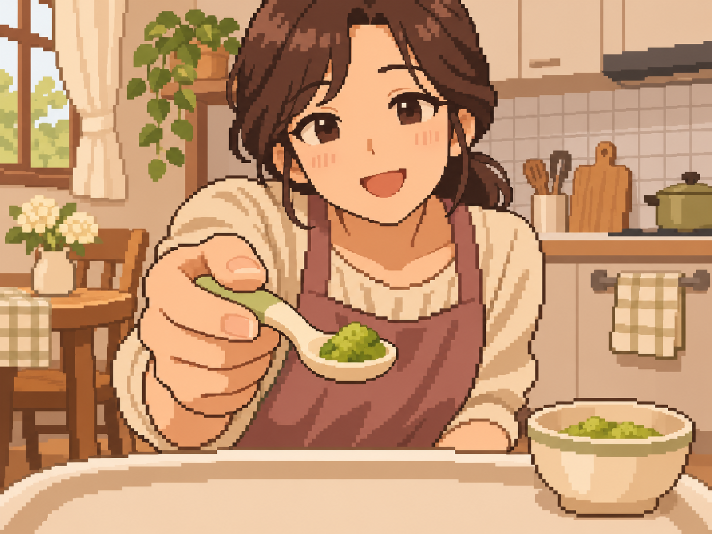
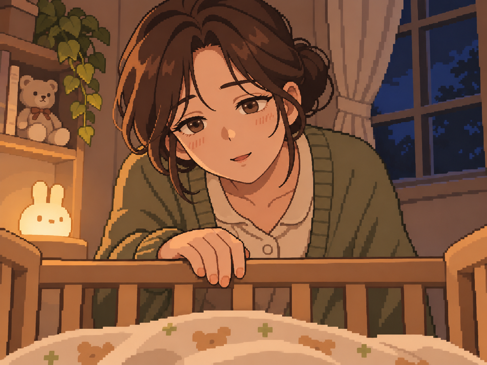
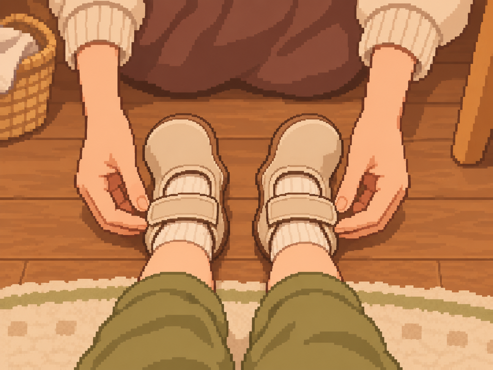
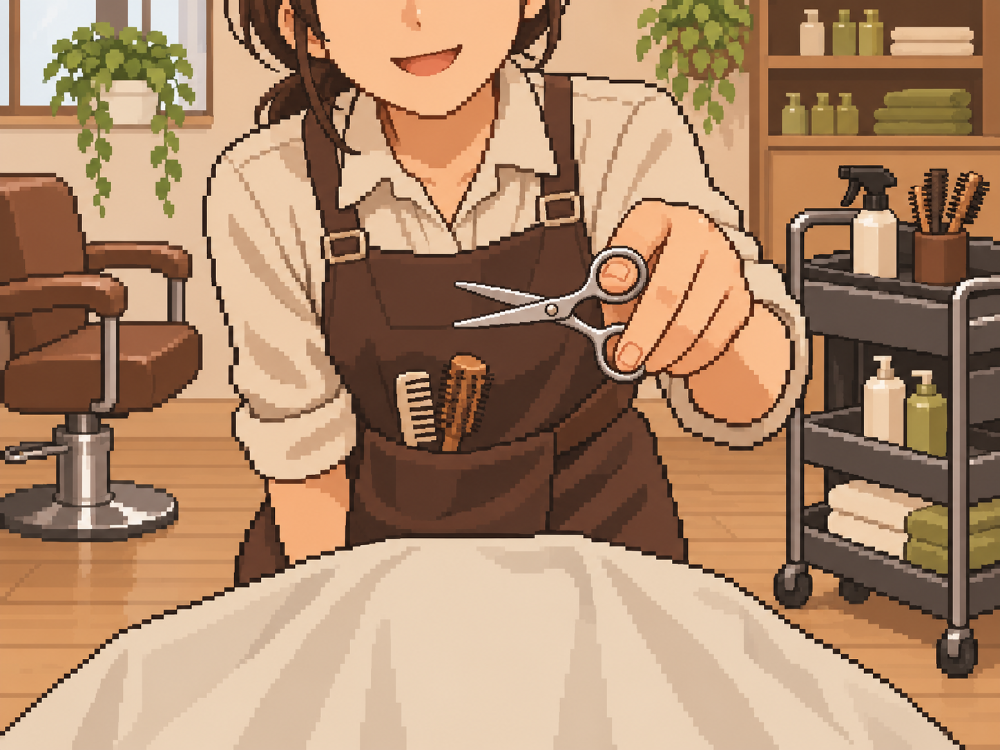
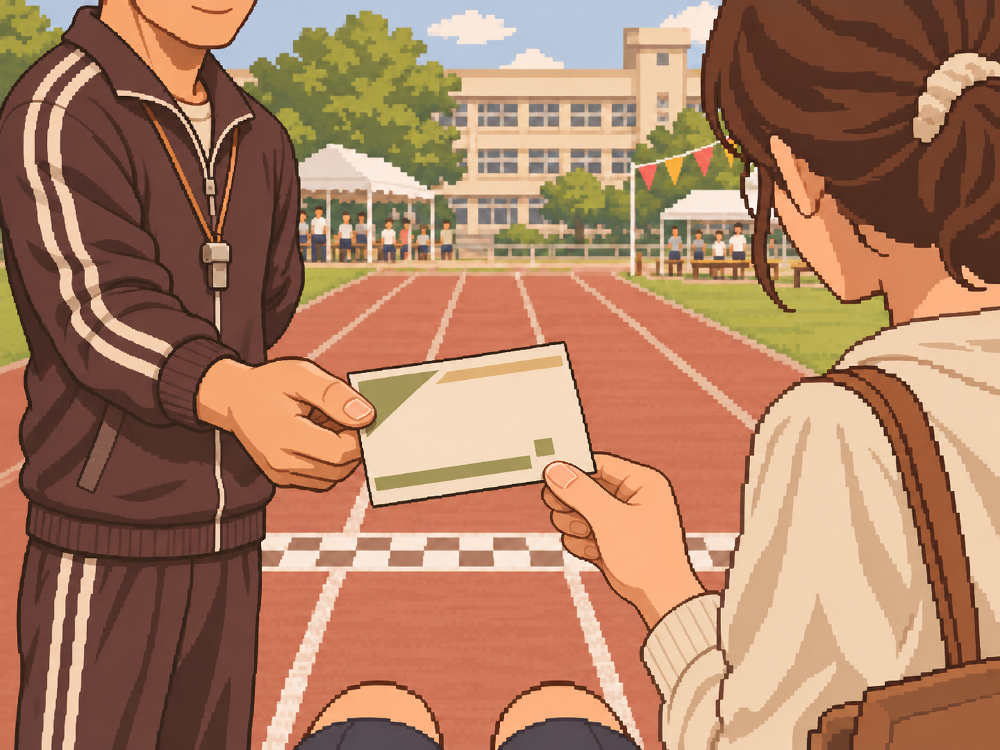
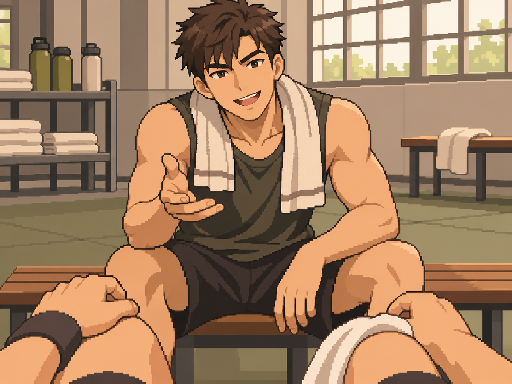
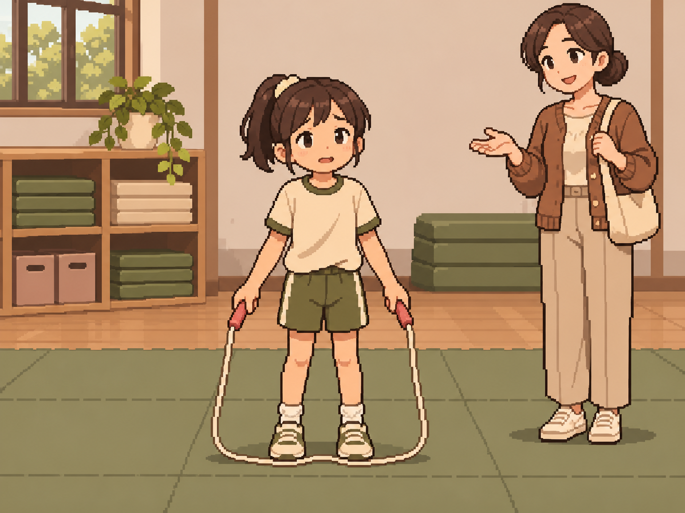
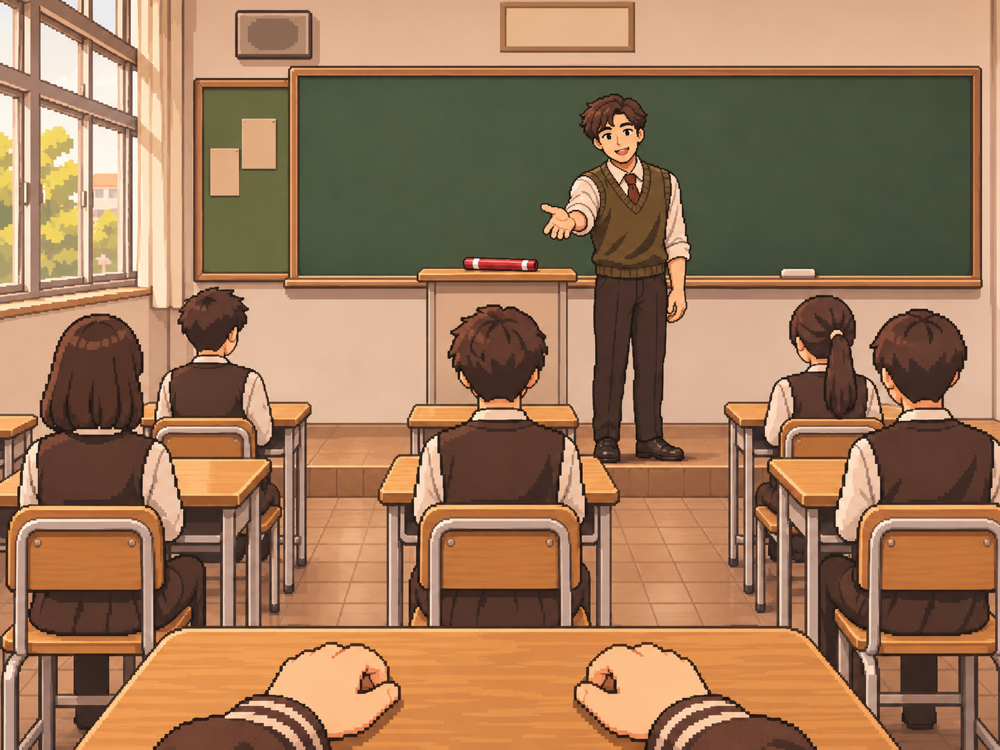

# 정원률 본 제작 6차 — 10장 검토 대기

최신 사용자 확인: 관장의 남는 팔을 몸 뒤로 둔 path_fit_01 재수정본에 'ㅇㅋ됐고 다음' 응답을 받았다.
7장 방향 확인과 관장 재수정본 확인은 기록했고, 교실·자장가 수정본은 별도 확인을 받았다고 추정하지 않았다.

## 사용자 검토와 수정

2026-11-05 사용자가 아래 세 장을 수정 요청했고 나머지 7장은 그림 방향을 확인했다.
내장 image_gen으로 해당 세 장만 편집하고 같은 프로젝트 경로에 갱신했다. 나머지 7장 PNG의 해시는 유지했다.

- path_fit_01: 손이 오른손 두 개로 보인다는 재지적을 받아 다시 수정했다. 남는 왼팔은 몸 뒤로 두고 명함을 내미는 한 손만 보이게 했다. 관장 한 손·어머니 한 손의 연결과 방향을 원본에서 재확인했다. 새 수정본은 사용자 확인 대기다.
- path_fit_18: 칠판 앞 작은 교탁과 그 옆 담임, 칠판을 향하는 학생 책상 열, 앞뒤 거리와 통로로 교실을 재구성했다.
- infant_006: 눈꺼풀과 입 모양을 온화한 자장가 표정으로 다듬었다. 야간 침대 시점과 배경은 유지했다.

세 수정본은 사용자 확인 대기다. 이전 PNG 해시·생성 경로·수정 프롬프트는 manifest의 revisionHistory와 completedEditPrompts에 보존했다.
이번 수정은 추가 제작 장수로 세지 않는다.

2026-11-05 · feat/Week10/wonryul · 기준 9ec953d

앞선 26장은 사용자 그림 방향 확인 완료다. 이번에도 10장 단위로 제작·검토한다.
내장 image_gen으로 영아 시점 6장과 운동 경로 4장의 PNG를 각각 생성하고 원본 1448×1086(4:3)을 그대로 저장했다.
리사이즈·코드 이미지 후처리는 하지 않았다. [전체 프롬프트·사건 명세·파일 정보](manifest.json) · [파일 검사 결과](validation.json).

| 사건 | 자체 시각 검토 |
| --- | --- |
| infant_001 브로콜리 반찬 | 영아의 낮은 시점, 엄마가 초록 반찬 숟가락을 내미는 순간. 비행기 실물·학교 급식·먹은 결과 없음. |
| infant_006 새벽 1시의 자장가 | 깨어 있는 영아의 침대 시점과 지친 엄마의 자장가. 야간등·밤 창문, 잠든 결과·아픈 아이·문자 없음. |
| infant_011 할머니의 그림책 | 할머니의 코끼리 그림책과 전화기. 책 글자·주인공 얼굴·전화 상대·촬영 성공 없음. |
| infant_016 거꾸로가 좋아 | 내려다보는 작은 두 발과 좌우가 뒤바뀐 신발 윤곽, 엄마 손. 거울·주인공 얼굴·바로잡은 결과 없음. 좌우 윤곽의 식별성은 사용자 확인 대기. |
| infant_021 첫 미용실 | 영아 의자 시점의 미용 망토·가위와 미용사. 거울 속 주인공 얼굴·사탕 수령·완성 머리 없음. |
| infant_026 볼풀에서 잃어버린 신발 | 볼풀의 두 발 중 신발은 한 짝만 보이고 다른 발은 양말. 잃은 짝을 찾은 결과 없음. |
| path_fit_01 체육관 관장님의 명함 | 초등 운동회 결승선 옆 관장과 어머니가 같은 무문자 명함을 확인. 주인공 얼굴·입단 결과 없음. |
| path_fit_06 주전 경쟁 | 훈련 후 성인 후배가 식사를 제안하는 대화. 특정 구기 종목·명단 선정·식당 도착·우승 없음. |
| path_fit_13 줄넘기 열 개를 못 넘는 제자 | 성인 코치 시점에서 줄에 걸려 멈춘 아이와 옆에 따로 선 어머니. 줄·양발이 함께 보임, 성공·꾸짖음 없음. |
| path_fit_18 체육대회 반 대표 | 청소년 교실에서 담임의 반 대표 제안과 책상 위 바통. 수락·경기·우승 전. |

## 그림

### infant_001 — 브로콜리 반찬

### infant_006 — 새벽 1시의 자장가

### infant_011 — 할머니의 그림책

### infant_016 — 거꾸로가 좋아

### infant_021 — 첫 미용실

### infant_026 — 볼풀에서 잃어버린 신발

### path_fit_01 — 체육관 관장님의 명함

### path_fit_06 — 주전 경쟁

### path_fit_13 — 줄넘기 열 개를 못 넘는 제자

### path_fit_18 — 체육대회 반 대표

## 검토와 수량

- 빌드 후 홈 → 디자인 미리보기 → 장면 고르기 → **41~50번**에서 확인한다.
- 앞선 26장 PNG의 해시를 확인했다. 이번 10장은 사용자 확인·팀 의미/화풍·실제 앱 크롭 검수 대기다.
- 원본 자체 시각 검토를 실제 앱 검수로 표시하지 않는다. infant_016 신발의 좌우 윤곽과 영아 눈높이·사물 크기는 사용자 검토가 필요하다.
- 자연스러운 원본 구도 우선. 일부 인물·손·책 외곽·주변 장비는 세로 중앙 크롭에서 제외될 수 있다.
- 중앙 사건 라우팅·카탈로그·승인 manifest는 유지했다. 기기 검수는 이전 ADB 연결 실패 이후 미실행이다.
- 본인 할당 69 = 기존 승인 4 + 새 PNG 검토 대기 36 + 아직 미제작 **29**.
- 미승인 잔량은 65그룹이다. 사용자 그림 방향 확인과 팀 최종 인수는 구분한다.
