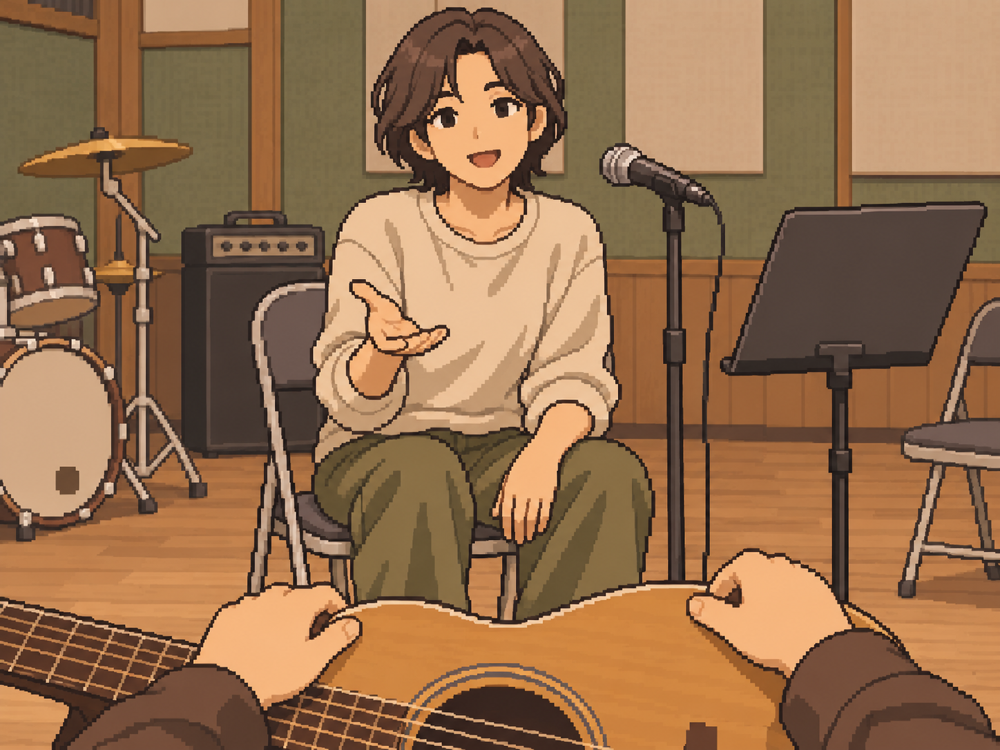
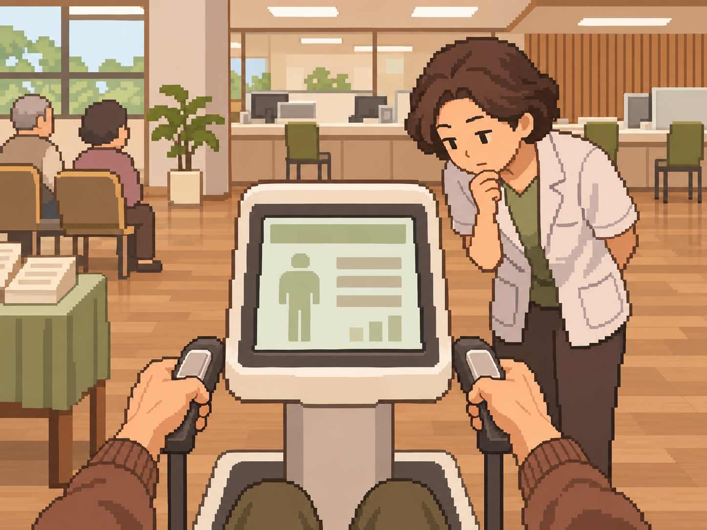
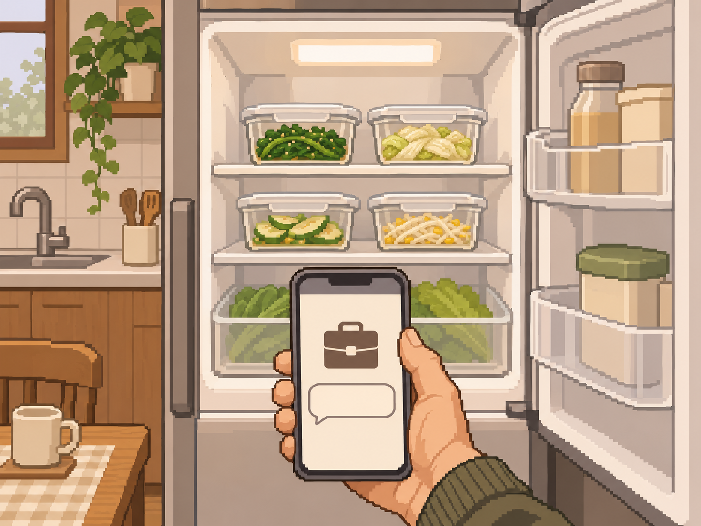
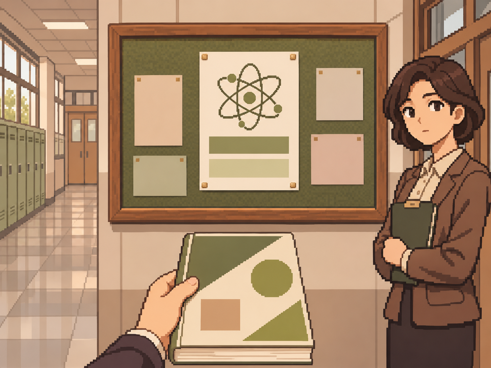
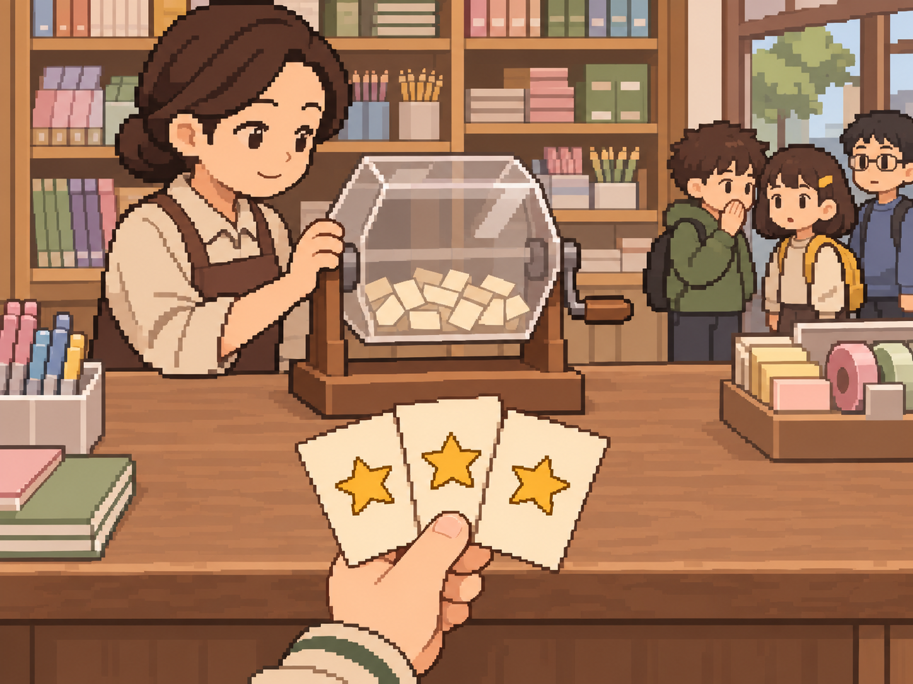
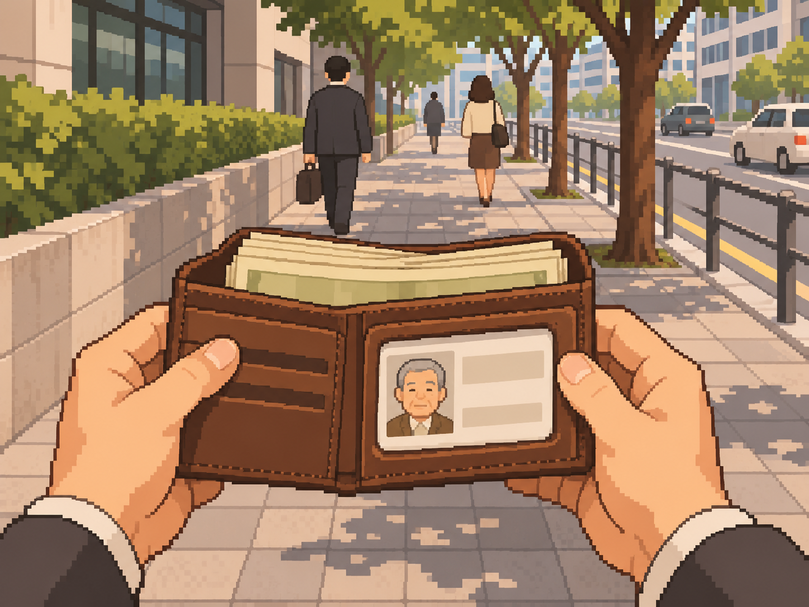

# 정원률 본 제작 7차 — 10장 검토 대기

사용자 확인: 2026-11-05 '별다른 문제는 없네. 다음' 응답으로 10장 그림 방향 확인. 팀·실제 기기 검수 승인은 별도다.

2026-11-05 · feat/Week10/wonryul · 기준 9ec953d

10장 단위 제작을 이어갔다. 내장 image_gen으로 각 사건의 PNG를 별도 생성하고 원본 1448×1086(4:3)을 그대로 저장했다.
리사이즈·코드 이미지 후처리는 하지 않았다. [전체 프롬프트·사건 명세·파일 정보](manifest.json) · [파일 검사 결과](validation.json).

| 사건 | 자체 시각 검토 |
| --- | --- |
| path_hap_05 취미 모임에서 만난 사람 | 합주 후 주인공 기타와 대화하는 성인 보컬, 곁의 마이크·악보대. 공연 중·연애·다음 참석 결과 없음. |
| path_hap_12 좋았던 일 하나 적기 | 집 수첩·펜과 짝을 이룬 삼각김밥 포장 두 개. 문자 1+1·상담 문구 없음. |
| path_hea_06 건강 나이 측정 | 보건소 측정 기계 화면을 직원이 재확인. 숫자·실제 건강 나이·진단·좋고 나쁜 결과 없음. |
| path_hea_13 완치 판정 1년 뒤 | 냉장고의 담백한 채소 반찬과 업무 연락 휴대폰. 소금 양은 그림으로 확정하지 않고 본문이 전달. 재발·입원·프로젝트 수락 없음. |
| path_int_02 영재교육원 선발 시험 | 학교 게시판의 무문자 과학 공문과 새 문제집, 곁의 담임. 시험장 입실·추천 확정·합격 없음. |
| path_int_07 졸업 앞의 세 갈래 | 학술 노트·채용 제안·시험 접수 자료 세 종류. 대학원·취업·시험 중 선택 전. |
| path_int_14 번아웃 뒤 다시 연 연구 노트 | 집 서재의 연구 노트와 멈춘 손·사용하지 않은 펜. 도식만 있고 연구 복귀·성과 결과 없음. |
| path_luk_01 문구점 뽑기 3연속 1등 | 문구점 뽑기 기계와 같은 별표 당첨권 정확히 세 장, 기계를 확인하는 사장과 대기 아이들. 실제 순위는 본문으로 전달. |
| path_luk_06 주운 지갑의 주인 | 출근길 열린 지갑·두툼한 무문자 현금·가상 노년 타인의 비식별 신분증. 주인공 얼굴·실존 회장·반환·보상 없음. |
| path_luk_13 공항에서 만난 사람의 메일 | 집 서재 모니터의 무문자 수신 메일과 보관 명함. 현재 공항·계약·사업 성공 장면 없음. |

## 그림

### path_hap_05 — 취미 모임에서 만난 사람

### path_hap_12 — 좋았던 일 하나 적기

### path_hea_06 — 건강 나이 측정

### path_hea_13 — 완치 판정 1년 뒤

### path_int_02 — 영재교육원 선발 시험

### path_int_07 — 졸업 앞의 세 갈래

### path_int_14 — 번아웃 뒤 다시 연 연구 노트

### path_luk_01 — 문구점 뽑기 3연속 1등

### path_luk_06 — 주운 지갑의 주인

### path_luk_13 — 공항에서 만난 사람의 메일

## 검토와 수량

- 빌드 후 홈 → 디자인 미리보기 → 장면 고르기 → **51~60번**에서 확인한다.
- 앞선 36장 PNG의 해시를 유지했다. 6차 path_fit_01 손 재수정본은 사용자 확인을 받았다. 6차 교실·자장가 수정본의 개별 확인은 추정하지 않았다.
- 이번 10장은 사용자 확인·팀 의미/화풍·실제 앱 크롭 검수 대기다. 원본 자체 시각 검토를 실제 앱 검수로 표시하지 않는다.
- 자연스러운 원본 구도와 핵심 사물 우선. 인물·종이·손 외곽과 측면 장비 일부는 세로 크롭에서 제외될 수 있다.
- 중앙 사건 라우팅·카탈로그·승인 manifest는 유지했다. 기기 검수는 이전 ADB 연결 실패 이후 미실행이다.
- 본인 할당 69 = 기존 승인 4 + 새 PNG 검토 대기 46 + 아직 미제작 **19**.
- 미승인 잔량은 65그룹이다. 사용자 그림 방향 확인과 팀 최종 인수는 구분한다.
