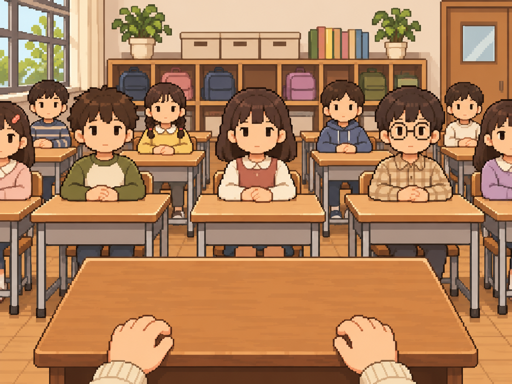
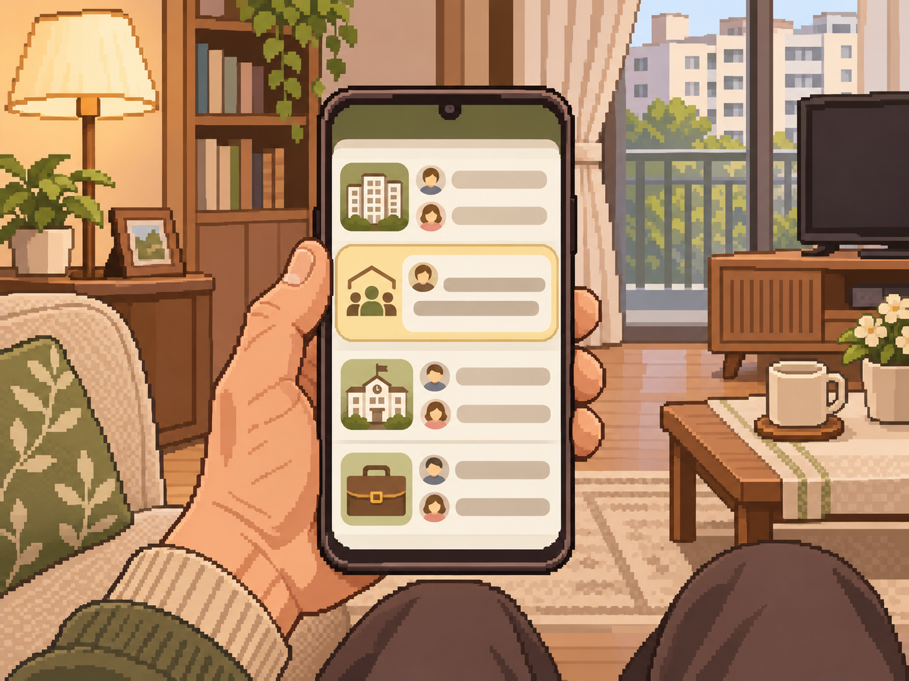
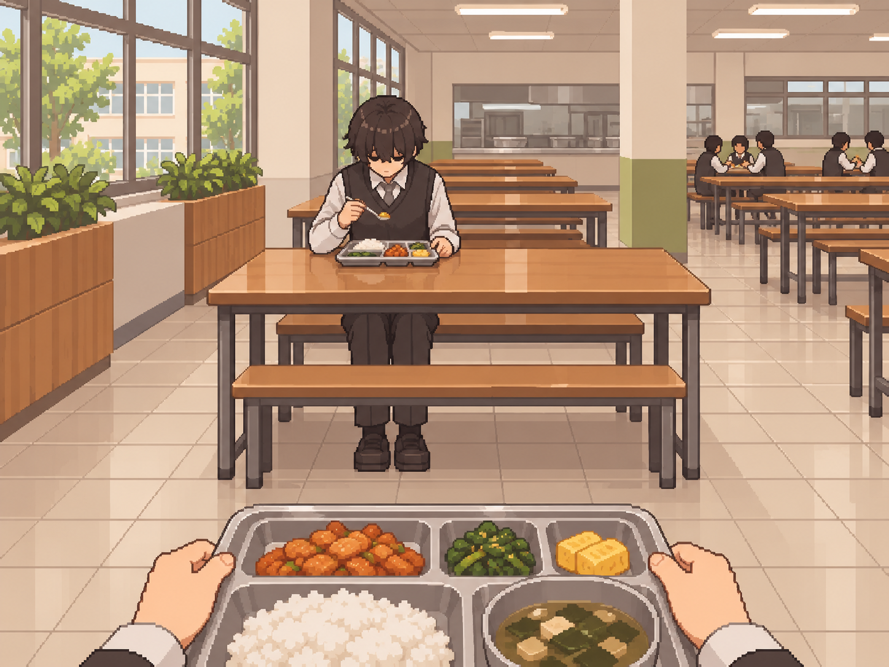
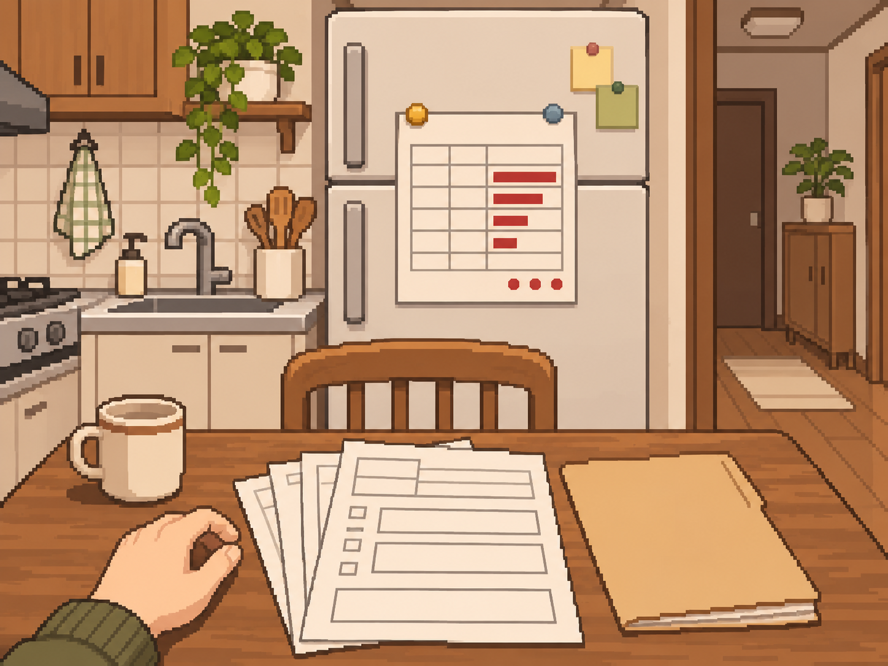
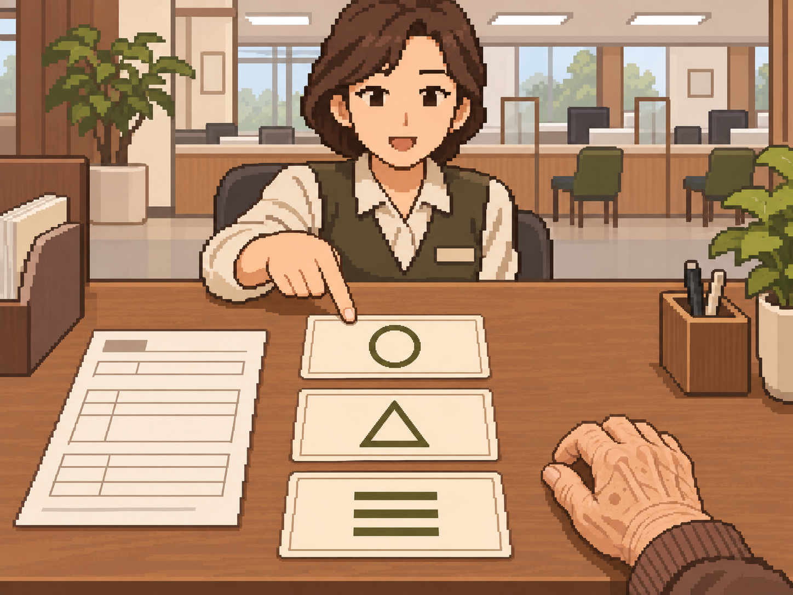
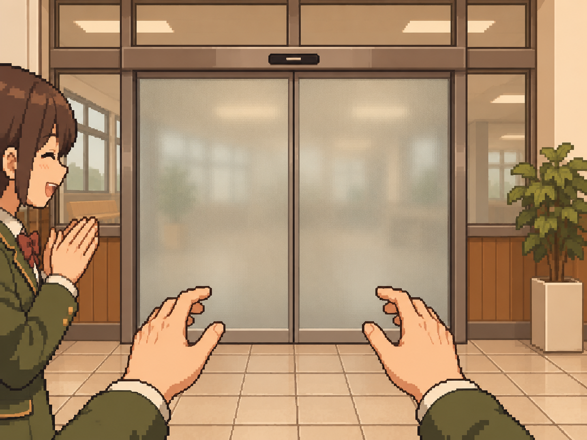
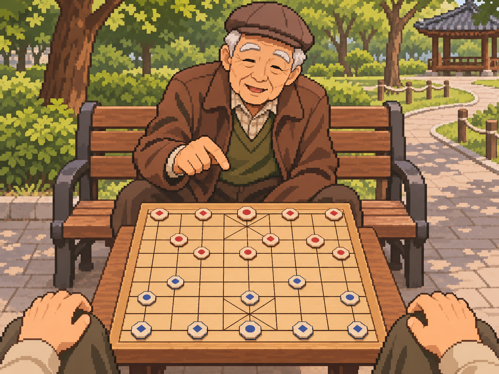
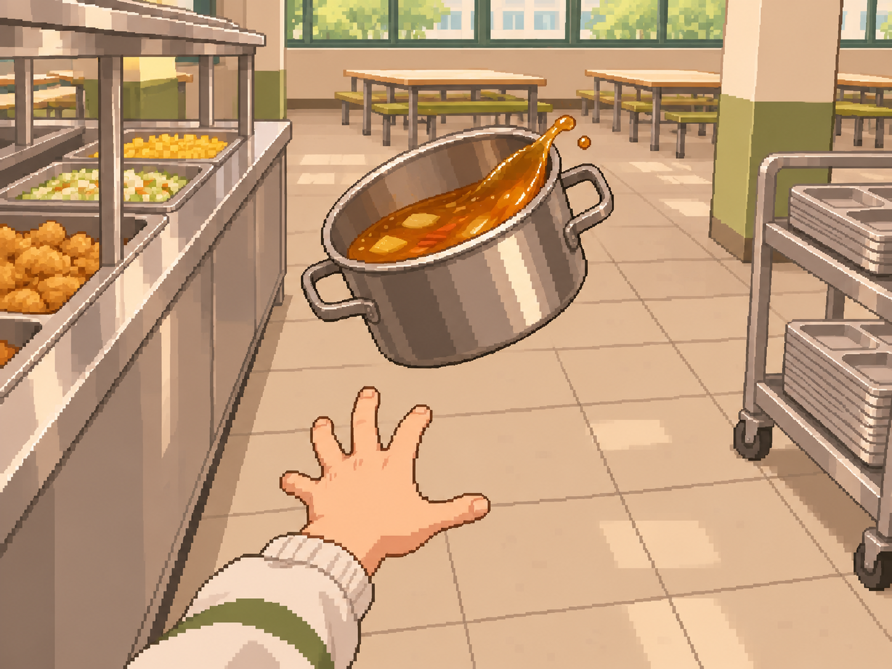

# 정원률 본 제작 8차 — 10장 검토 대기

최신 사용자 확인: path_soc_13의 종이를 책상에 눕힌 수정본에도 'ㅇㅋ다음' 응답을 받았다. 이 묶음 10장 그림 방향 확인 완료, 팀·기기 검수 승인은 별도다.

사용자 검토: 2026-11-05 path_soc_13 제외 9장의 그림 방향 확인 완료.
path_soc_13은 계약 서류가 떠 보인다는 지적을 받아, 책상 위에 완전히 눕혀진 종이가 되도록 원근과 접촉 가장자리를 수정했다.
종이 뒤쪽에 책상 나무 면이 드러나고 서류 면이 휴대폰·키보드와 같은 책상 평면을 따른다.
수정본은 사용자 확인을 받았고, 나머지 9장 파일은 유지했다. 이전 해시·생성 경로·수정 프롬프트는 manifest에 보존했다.

2026-11-05 · feat/Week10/wonryul · 기준 9ec953d

내장 image_gen으로 사회성·경제력·돌발 사건 PNG 10장을 별도로 생성했다. 원본 1448×1086(4:3)을 그대로 저장했다.
리사이즈·코드 이미지 후처리는 하지 않았다. [전체 프롬프트·사건 명세·파일 정보](manifest.json) · [파일 검사 결과](validation.json).

| 사건 | 자체 시각 검토 |
| --- | --- |
| path_soc_01 반장 선거 연설 | 초등 반장 후보 시점에서 바라보는 친구들과 빈 책상·손. 연설문·당선·박수 없음. |
| path_soc_06 동네가 나를 부른다 | 집 소파에서 여러 그룹 연락과 위원장 권유를 확인하는 휴대폰. 숫자 2000·출마·당선 없음. |
| path_soc_13 영업 1등의 슬럼프 | 계약 서류를 책상 위에 눕힌 원근·접촉 가장자리로 수정. 재직 중 사무실과 수신 메시지, 무서명 상태 유지. |
| path_soc_18 전학 온 친구의 첫 점심 | 중학생 교복·체형과 외딴 급식실 자리. 초등 전학생·회상 합성·합석 결과와 구분. |
| path_wea_05 내 집 마련 상담 | 중년 고객 시점, 주택 대출 상담 서류·계산기와 직원. 집 구매·승인 확정·실제 금리 없음. |
| path_wea_12 실직 석 달째 | 집 구직 지원 자료와 냉장고의 붉은 무문자 가계부. 현재 재직 중 영업 슬럼프와 구분. 재취업·파산 없음. |
| path_wea_17 빚 정리 상담 | 노년 고객 손, 기존 대출 서류와 구분되는 선택 카드 세 장. 완납 결과·새 주택 취득 없음. |
| special_005 나를 거부하는 자동문 | 닫힌 학교 센서 자동문과 측면에서 박수치는 학생. 회사 사원증 거부와 구분, 문 개방 결과 없음. |
| special_010 공원 벤치의 장기 고수 | 공원 벤치의 노인과 장기판. 장기 말은 글자 대신 적·청 도형으로 구분. 승패·개인정보 문서 없음. |
| special_015 날아가는 탕수육 소스 | 급식실에서 공중에 기울어진 탕수육 소스 통과 미끄러진 손. 바닥 낙하·사람에게 쏟은 결과·부상 없음. |

## 그림

### path_soc_01 — 반장 선거 연설

### path_soc_06 — 동네가 나를 부른다

### path_soc_13 — 영업 1등의 슬럼프

### path_soc_18 — 전학 온 친구의 첫 점심

### path_wea_05 — 내 집 마련 상담

### path_wea_12 — 실직 석 달째

### path_wea_17 — 빚 정리 상담

### special_005 — 나를 거부하는 자동문

### special_010 — 공원 벤치의 장기 고수

### special_015 — 날아가는 탕수육 소스

## 검토와 수량

- 빌드 후 홈 → 디자인 미리보기 → 장면 고르기 → **61~70번**에서 확인한다.
- 앞선 46장 PNG의 해시를 유지했다. 7차의 10장은 사용자 그림 방향 확인을 받았다.
- 이번 10장은 사용자 확인·팀 의미/화풍·실제 앱 크롭 검수 대기다. 원본 자체 시각 검토를 실제 앱 검수로 표시하지 않는다.
- 자연스러운 원본 구도와 핵심 사물 우선. 주변 인물·손·계산기·장기판 가장자리 등은 세로 크롭에서 일부 제외될 수 있다.
- 중앙 사건 라우팅·카탈로그·승인 manifest는 유지했다. 기기 검수는 이전 ADB 연결 실패 이후 미실행이다.
- 본인 할당 69 = 기존 승인 4 + 새 PNG 검토 대기 56 + 아직 미제작 **9**.
- 미승인 잔량은 65그룹이다. 사용자 그림 방향 확인과 팀 최종 인수는 구분한다.
