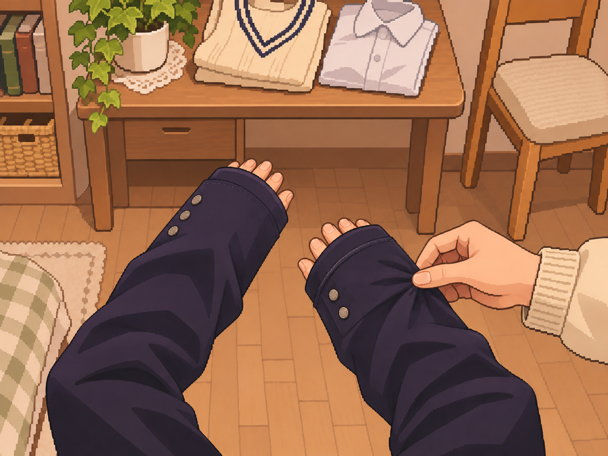
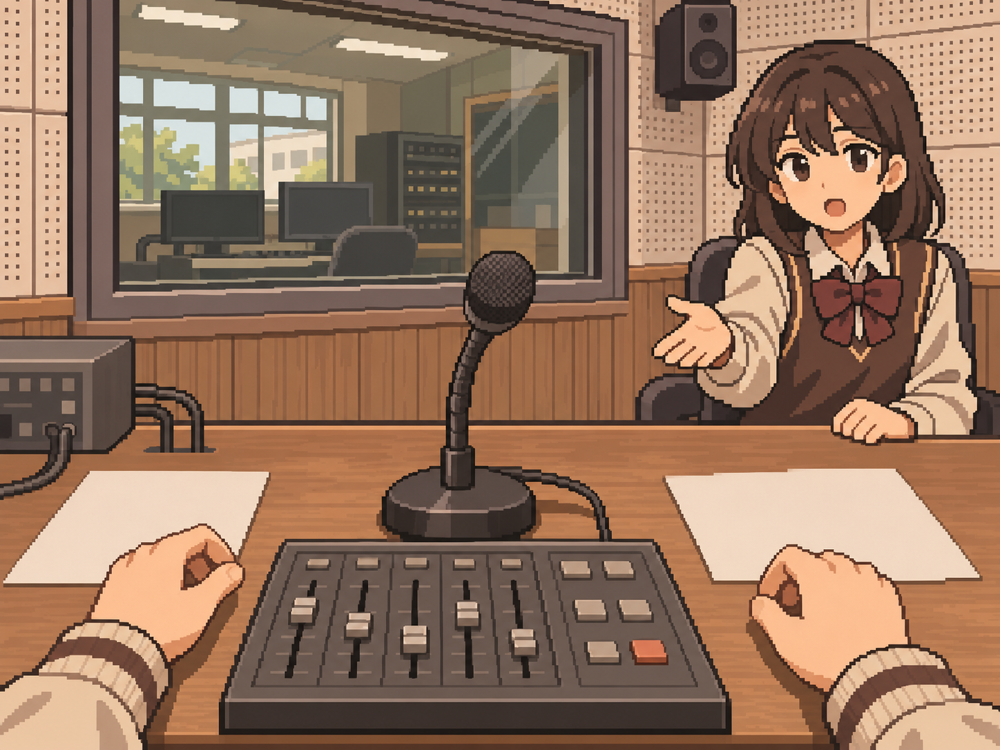
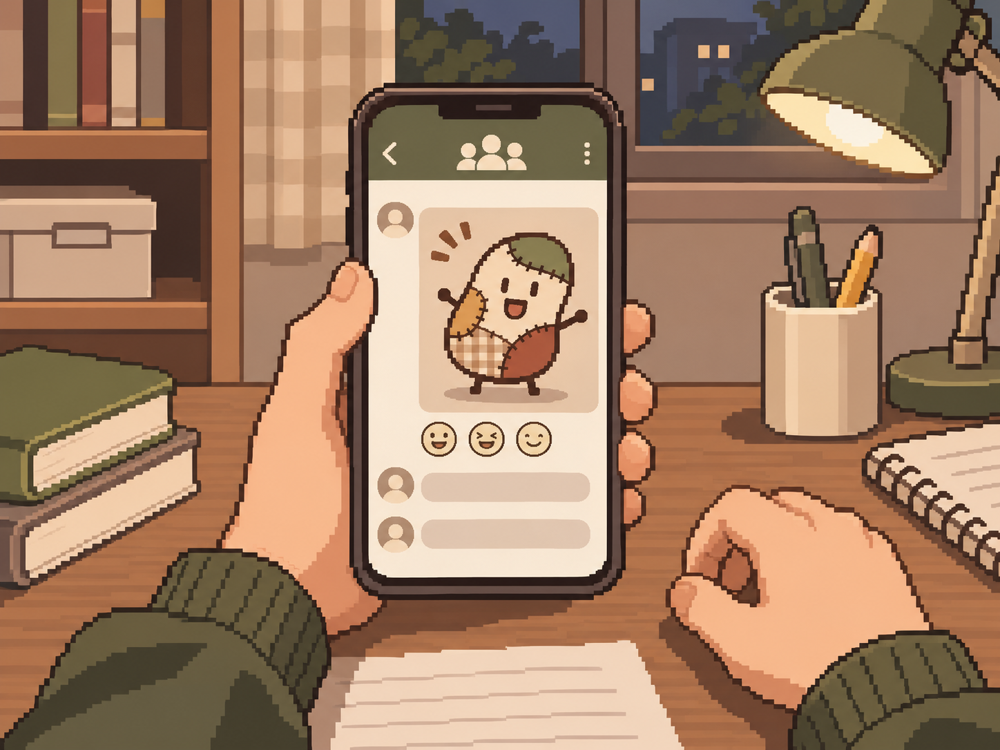
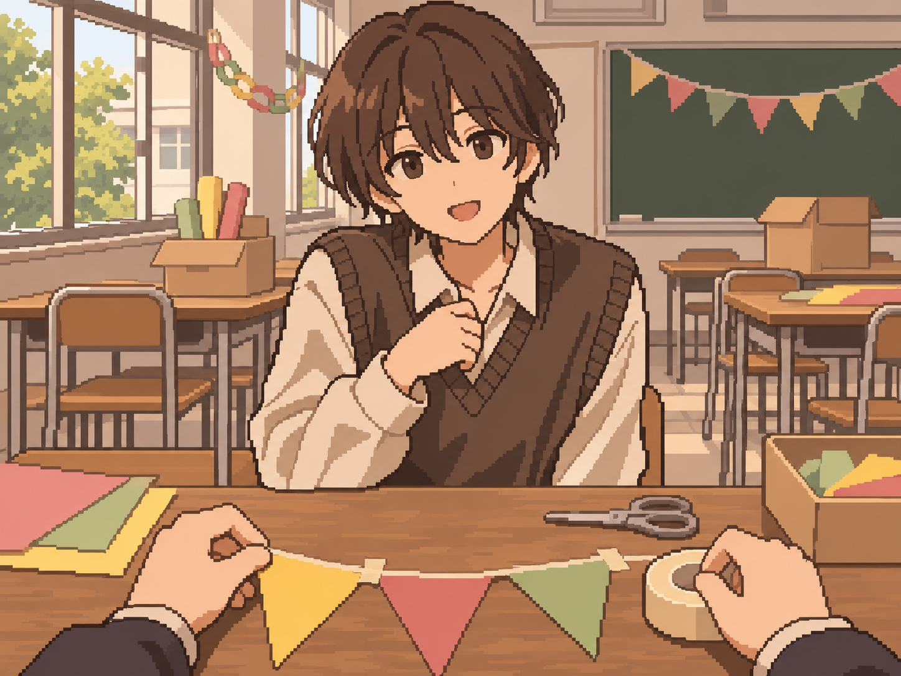
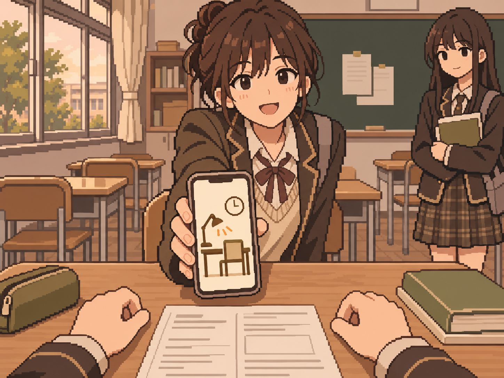
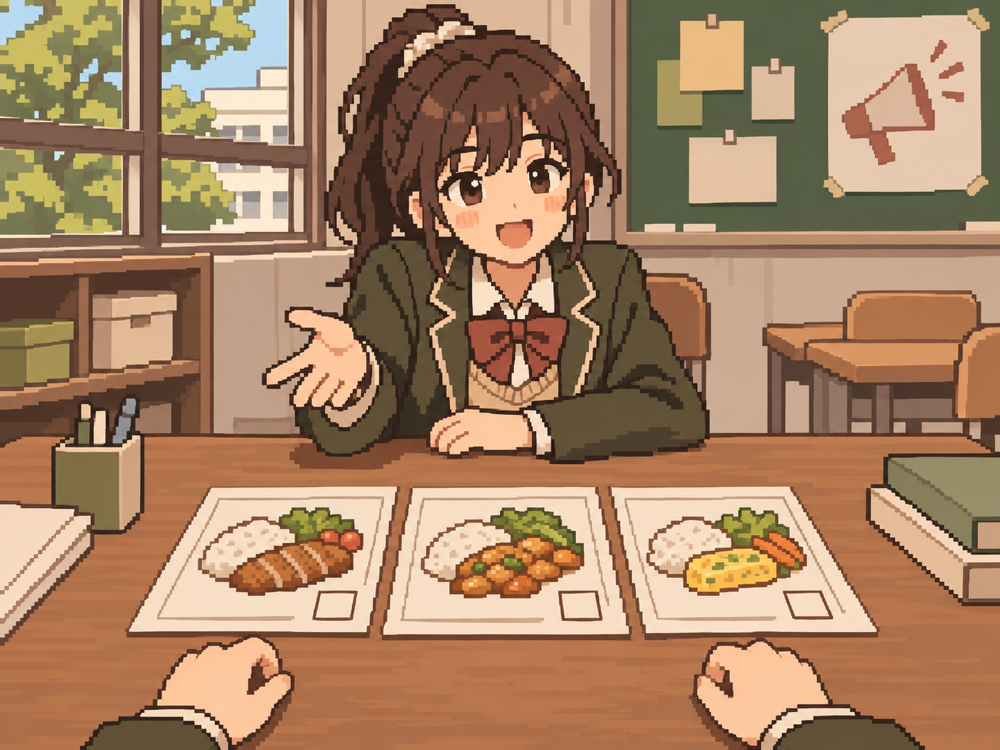

# 정원률 본 제작 9차 — 마지막 9장 검토 대기

사용자 확인: 2026-11-05 마지막 9장에 '별다른 문제는 없어 보이네' 응답을 받았다. 그림 방향 확인 완료이며 팀·실제 앱/기기 검수 승인은 별도다.

2026-11-05 · feat/Week10/wonryul · 기준 9ec953d

미제작으로 남았던 청소년 사건 9장을 내장 image_gen으로 별도 생성했다. 교복은 팔이 다리처럼 보이지 않도록 소맷단·단추·굽힌 팔 구도를 추가 편집했다.
원본 1448×1086(4:3)을 그대로 저장했고 리사이즈·코드 이미지 후처리는 하지 않았다.
[전체 프롬프트·사건 명세·파일 정보](manifest.json) · [이번 묶음 검사](validation.json) · [본인 배정 69그룹 파일 전수 목록](owner_file_inventory.json).

| 사건 | 자체 시각 검토 |
| --- | --- |
| teen_001 처음 입는 교복 | 집에서 긴 교복 소매를 내려다봄. 팔이 다리처럼 읽히던 초안을 굽힌 양팔·소맷단 단추·손끝으로 보완. 어머니 손은 소매 확인만, 수선·학교 등교·거울 얼굴 없음. |
| teen_006 점심 방송 사고 | 학교 방송실 책상의 마이크·믹서와 대타 요청 학생. 방송 사고·송출 시작·숫자 카운트다운 없음. |
| teen_011 단톡방의 사진 | 단체 대화방의 비식별 창작 아바타 그림과 반응 아이콘. 실제 모욕 사진·이름·읽을 글자·주인공 얼굴·신고/가담/위로 결과 없음. |
| teen_016 부모님 결혼기념일 | 빈 달력 칸의 동그라미와 지폐 한 장의 얇은 지갑. 날짜·액수·신분증·구매한 선물 없음. |
| teen_021 축제와 짝사랑 | 학교 축제 준비 중 먼저 말을 거는 동년배. 데이트·고백·무대 성공 결과 없음. |
| teen_026 새벽의 메시지 | 야간 수학 자료와 친구의 단일 수신 메시지. 식별 정보·상해 장면·만남·문제 해결 없음. |
| teen_031 스터디 카페 | 방과 후 교실에서 친구가 스터디 장소를 제안하며 무문자 안내를 보여줌. 실제 카페 입실·결제 없음. |
| teen_036 학생회장 선거 공약 | 후보인 친구의 도움 요청과 급식 메뉴 그림 카드. 주인공이 후보인 초등 연설과 구분, 당선·투표제 시행 없음. |
| teen_041 아무 일 없는 주말 | 비어 있는 탁자와 조용한 오후 휴식 시점. 게임·외출·공부를 선택한 소품이나 결과 없음. |

## 그림

### teen_001 — 처음 입는 교복

### teen_006 — 점심 방송 사고

### teen_011 — 단톡방의 사진

### teen_016 — 부모님 결혼기념일

### teen_021 — 축제와 짝사랑

### teen_026 — 새벽의 메시지

### teen_031 — 스터디 카페

### teen_036 — 학생회장 선거 공약

### teen_041 — 아무 일 없는 주말

## 범위와 수량

- 빌드 후 홈 → 디자인 미리보기 → 장면 고르기 → **71~79번**에서 확인한다.
- 앞선 56장 PNG 파일의 해시를 유지했다. 8차의 서류 원근 수정본도 사용자 확인을 받았다.
- 본인 할당 69 = 기존 승인 4 + 이번 작업 PNG 검토 대기 65 + 미제작 **0**.
- 65장의 실제 PNG 생성·저장은 마쳤다. 이번 9장은 사용자 확인 대기다. 다른 묶음의 개별 확인 상태는 각 manifest를 따른다.
- 팀 의미/화풍·실제 앱 크롭·기기 검수는 별도다. 원본 자체 시각 검토와 파일 생성 완료를 최종 인수 승인으로 표시하지 않는다.
- 중앙 사건 라우팅·카탈로그·승인 manifest는 유지했다. 기기 검수는 이전 ADB 연결 실패 이후 미실행이다.
- 본인 배정 전량의 실제 파일 존재·PNG 청크 CRC·4:3 크기·해시는 owner_file_inventory.json에 기록했다.
