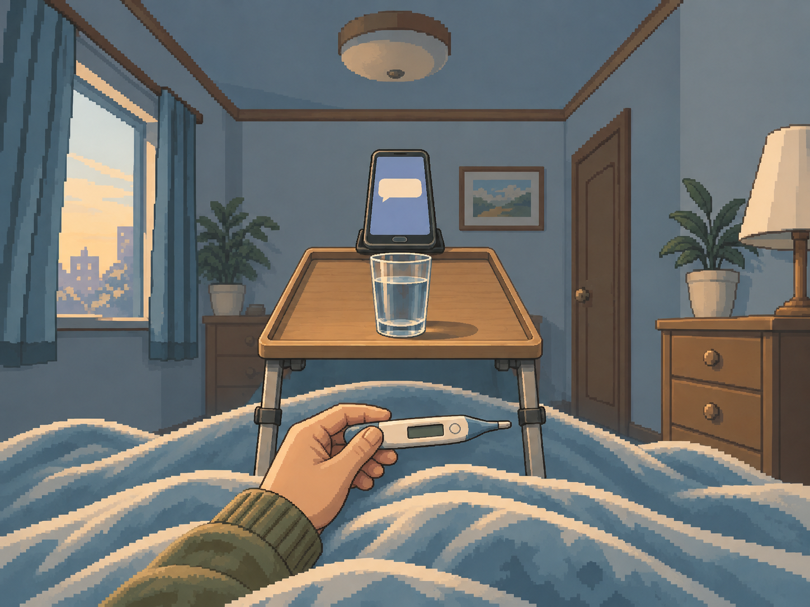
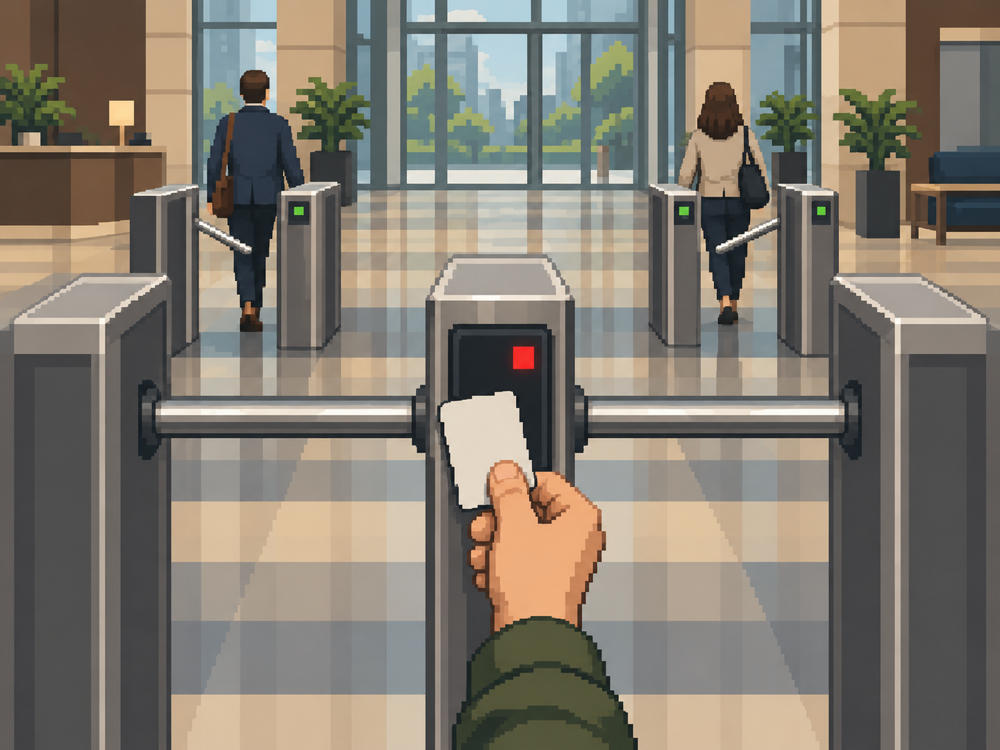
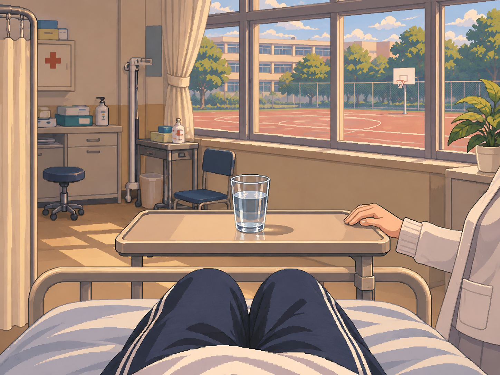
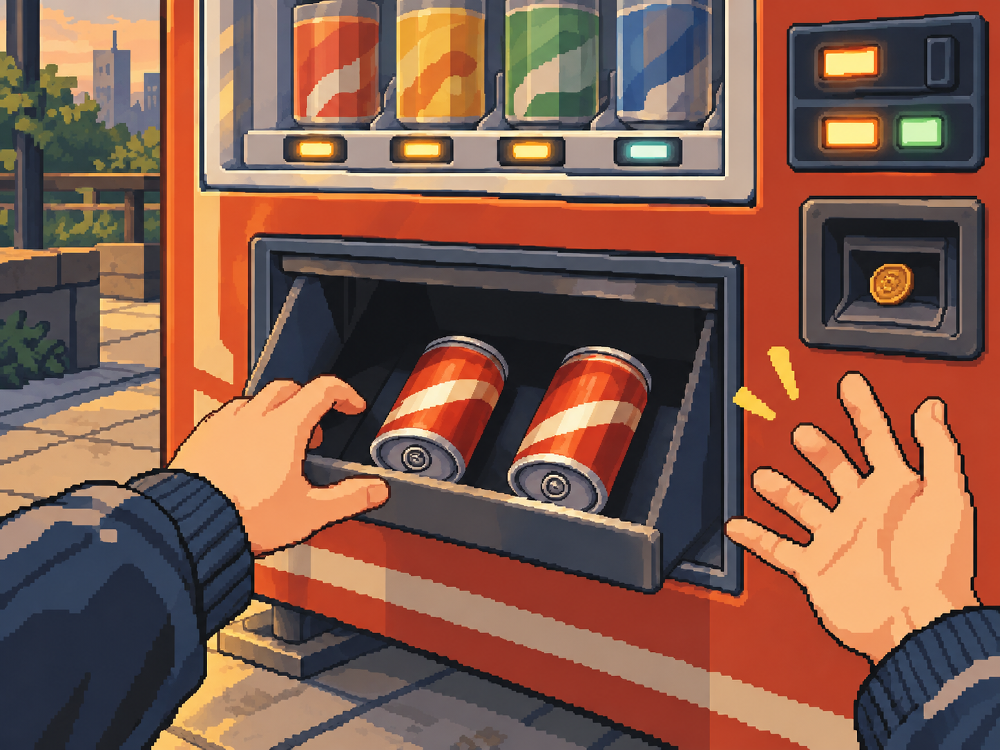

# 2차 피드백·최신 제작 지시 대응 — 정원률 / 2026-11-03

**완료:** 의미 수정 13행, 기존 PNG 보완 4장, 17건 현재 시각 판정 정리, 신규 공통 샘플 2장 제작·미리보기.
기존 예술고·도서관 2장은 유지한다. main이나 다른 브랜치와 병합하지 않고 기존 PR #50에 추가 제출한다.

## 최신 지시와 수량

작업 중 [PR #51](https://github.com/sunhan2002-cyber/hansung-lifegame/pull/51)의 새 커밋 **`dc7e6e9a3939e807bb6c182c76b0bb426a9f62da`**을 다시 회수했다.
이 커밋이 이전 ‘수량·담당 미확정’ 상태를 대체한다. 김선한의 제작대장·착수 명세를 덮어쓰지 않았다.

| 항목 | 최신 팀 제출 기준 | 이번 정원률 대응 |
| --- | --- | --- |
| 전체 | 352사건, 351그룹, 원본 재사용 3 + 기제출 수정본 2, 추가 제작 346 | 수량을 임의로 다시 계산하거나 그룹 합치지 않음 |
| 정원률 | 총 69장 중 기제출 2장 인정, **추가 배정 67장** | 신규 공통 샘플 2장 제작·제출, 나머지 **65장**은 샘플 검토 후 |
| 공통 샘플 | 급식 path_hea_01 + 공유 첫 월급 adult_015/adult_080 + 기존 도서관 path_int_10 | 신규로 필요한 앞의 **2장 제작**, 기존 도서관 유지 |
| 기존 그림 4장 보완 | 타 담당자에게 배정된 수정 장면 | 이번에 제공한 수정 후보. 정원률 추가 67장에서 차감하지 않음; 담당자 검토·대장 반영 필요 |

제작량과 PNG 최종 승인은 구분한다. 샘플 자체 검토를 팀 의미·크롭·화풍 승인으로 대신하지 않았다.
개인 분류 CSV의 승인·제작 칸은 초기 분류 제출 양식을 보존한다. **실제 제작 담당·상태는 최신 PR #51 제작대장을 따른다.**

## 의미 수정 13행

[PR #49 댓글](https://github.com/sunhan2002-cyber/hansung-lifegame/pull/49#issuecomment-6596006621)의 12건과 달리,
의미 CSV `afd2f6bf4e3d7bc4229027b928fc96635ddc1d00`에는 정원률 FIX **13행**이 있었다. 전부 대응했다.
최종 장소·구도는 새 PR #51의 잠긴 제작 명세와 대조해 통일했다. 초기의 소파·정류장 등 다른 제안은 현재 CSV에 남기지 않았다.

| 사건 | 최종 제작 장소 | 현재 행동 |
| --- | --- | --- |
| `adult_010` | adult_007·008·009와 같은 고깃집 테이블 | 다 구운 뒤 마지막 고기와 계산서를 내려다봄 |
| `adult_015` | 집 목재 책상(연출 확정) | 급여 입금 알림을 확인하며 은행 앱을 새로고침 |
| `adult_030` | 결혼식 전 카페 테이블(연출 확정) | 친구에게 청첩장을 받으며 축사 부탁을 들음 |
| `adult_035` | 퇴근 뒤 집 방 책상(연출 확정) | 동창회 공지를 받고 낯익은 프로필을 훑음 |
| `adult_077` | 집 식탁(연출 확정) | 모르는 번호에서 온 첫사랑의 문자를 확인 |
| `child_020` | 집 책상(연출 확정) | 분해하기 전 멈춘 벽시계와 드라이버를 봄 |
| `path_hap_12` | 집 책상(연출 확정) | 수첩에 오늘 좋았던 일을 적는 첫날 |
| `path_int_14` | 집 서재 책상(연출 확정) | 한동안 쉬었던 연구 노트를 펼쳤다 덮었다 고민 |
| `path_luk_13` | 집 서재 책상(연출 확정) | 예전에 공항에서 만난 사람의 제안 메일을 확인 |
| `path_soc_06` | 집 거실 소파(연출 확정) | 여러 관계망의 연락과 위원장 출마 권유를 확인 |
| `teen_011` | 집 방 공부 책상(연출 확정) | 단톡방의 조롱 합성 사진을 보고 멈춤 |
| `teen_026` | 집 수학 공부 책상(연출 확정) | 친구의 힘들다는 메시지와 다음 날 시험 자료를 봄 |
| `teen_031` | 방과 후 교실(연출 확정) | 친구들이 시험 기간의 공부 장소를 제안 |

adult_010은 **취한 친구들**로, adult_030은 **결혼식 전 부탁**으로 고쳤다. 본문에 없는 장소·시각은 제작 연출이다.
70행·26열·사건 ID/본문 등 원본 11열은 유지했다. 변경 행은 13개이며 승인자나 최종 승인 그룹을 대신 쓰지 않았다.
[행별 응답](../../정원률_2차수정응답.csv)과 [고정한 근거](review_sources.json)를 함께 제출한다.

## 재사용 판단의 최종 반영

- **첫 월급 쌍 공유 채택:** PR #51의 `grp_shared_salary_deposit`를 따른다. 집 목재 책상·저녁·나이 강조 없는 성인 손·입금 확인 구도. early_job 필수/차단으로 조건이 배타적이다.
- **대출 쌍 분리 유지:** adult_041/path_wea_05의 공용 상담 구도 가능성을 검토했으나 최신 통합 담당 결정은 반복 노출·별도 시각 합의 미완료를 이유로 분리다. 이 결정을 수용하고 path_wea_05의 원래 별도 후보를 복구했다. N=351과 제작 배정을 바꾸지 않았다.

[그룹 제안/최신 반영 JSON](../../정원률_재사용그룹제안.json)에 제안과 채택·분리 결과를 구분했다.

## 기존 PNG 보완 네 장

모두 원본을 참조한 내장 image_gen 편집 결과다. 외부 이미지를 가져오지 않았고 생성 원본 **1448×1086**을 그대로 적용했다.
코드로 이미지 자르기·확대/축소·색상 치환을 하지 않았다. 기존 imageId·경로를 유지하고 설명·크기·해시·출처를 갱신했다.
[프롬프트·출처](prompts_and_sources.json), [전후 해시·적용 경로](application_record.json), [수정 전 원본](originals)을 보존한다.

| 미리보기 | 사건 | 수정 |
| --- | --- | --- |
| 7 | adult_068 몸살 | 휴대폰·물컵·체온계를 침대 앞 중앙에 세로 배치 |
| 8 | adult_070 출입문 | 사원증·빨간 거절 표시·닫힌 게이트를 함께 중앙 배치 |
| 11 | path_hea_09 보건실 | 가짜 글자 메모 제거, 물컵 중앙 트레이 이동, 교사 손/옷 일부 추가 |
| 12 | path_luk_09 자판기 | 원래도 두 캔인 개수 유지, 두 배출 캔을 같은 무상표 콜라 색으로 통일 |

자판기 위쪽 진열 캔을 배출 캔 개수에 합산하지 않았다. ‘3개를 2개로 고쳤다’고 기록하지 않는다.
보건 교사·주변 인물·양옆 손은 세로 화면에서 잘릴 수 있지만 핵심 사물은 중앙에 유지한다.

## 공통 샘플 두 장

[샘플 제출 문서·manifest](../../samples/20261103/README.md)에 새 PNG·그룹 ID·목표 경로·SHA-256·프롬프트·자체 검토를 제공한다.
앱 자산에는 지정 목표 경로로 넣고 **미리보기 13·14번**에서 검토할 수 있게 했다.
팀 샘플 승인 전이므로 사건 라우팅·중앙 카탈로그를 최종 연결하지 않았다. 통합은 김선한·김재겸 순서를 따른다.

- 급식: 식판의 기존 브로콜리 **3송이**와 짝꿍 손이 옮기는 **추가 1송이**를 구분한다. 중앙에 영양사·추가 동작·브로콜리, 먹기 전 상태.
- 첫 월급: 집 목재 책상·저녁·성인 손·무문자 입금 아이콘. 나이·금액·은행·새로고침 횟수·지출 결과를 확정하지 않는다.
- 기존 도서관을 포함한 3종의 의미·크롭·화풍 검토 뒤 나머지 65장을 제작한다. 파일럿/샘플을 별도 장수로 더하지 않는다.

## 17건 판정과 실제 실행에서 찾은 문제

[현재 17건 시각 판정](../../정원률_2차시각판정.csv): 수정본 6건 제공 + 원본 3건 재사용 지지 + 수정/교체 필요 8건.
예술고·도서관 두 수정본은 PR #49 의미 승인과 PR #47 핵심 유지 크롭 의견을 수용했다.
남은 8건은 path_fit_09, path_hap_10, path_hea_10, path_luk_10, path_soc_09, path_soc_10, path_wea_10, teen_042다.
이 시각 검토 숫자를 공식 R/M으로 덮어쓰지 않는다. 최종 PNG 인수와 대장 반영은 별도다.

[1차 원본 검토표](../../정원률_기존이미지17건_시각검토.csv)는 기준 main의 원본 평가·해시를 보존한다.
교체된 총 6개 원본은 별도 스냅샷, 나머지 11개는 기존 앱 파일과 해시가 같다.

실제 APK/화면에서 예전 `src/debug/assets` 몸살·출입문 사본이 최신 main 그림을 덮어쓰는 문제를 발견했다.
두 중복 사본을 제거해 같은 최신 PNG를 읽게 했고 `validate_images.py`에 다른 바이트의 debug 덮어쓰기 감지를 추가했다.
옛 사본 재현 시 실패하고 복구 후 통과하는 것도 확인했다.

Android 16의 Compose captureToImage가 검사 스레드로 다시 그리며 충돌한 실행도 확인했다.
최종 검사 캡처는 **앱의 최상위 창(전체화면 Dialog 포함)을 UI 스레드에서 그리는 방식**이다.
에뮬레이터 System UI 응답 지연 안내가 포함된 전체 기기 캡처는 시각 승인 근거로 사용하지 않는다.
기존 탐색·선택·전체화면·복귀·작은 화면 검증은 유지했다.

## 검증과 다음 단계

최종 실행·파일 대조·APK 해시·앱 창 캡처 관찰은 [validation.json](validation.json)에 기록한다.
홈 → 디자인 미리보기 → 장면 고르기: 총 **14장**, 수정 7·8·11·12번, 신규 샘플 13·14번, 기존 수정 9·10번.
필름은 원본 전체, 전체화면은 실제 SceneBackdrop 중앙 크롭, 터치/뒤로 가기로 복귀한다.

신기훈 의미·김재겸 실제 크롭·정원률 화풍 검토가 남아 있다. 샘플 3종 승인 뒤 나머지 65장과 전원 시각 검수를 진행한다.
최종 사건 연결·승인 manifest·전수 QA가 끝나기 전 과제 전체 완료로 보고하지 않는다.
