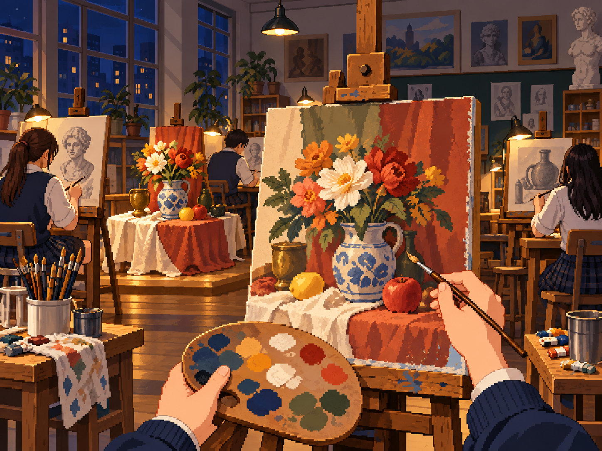
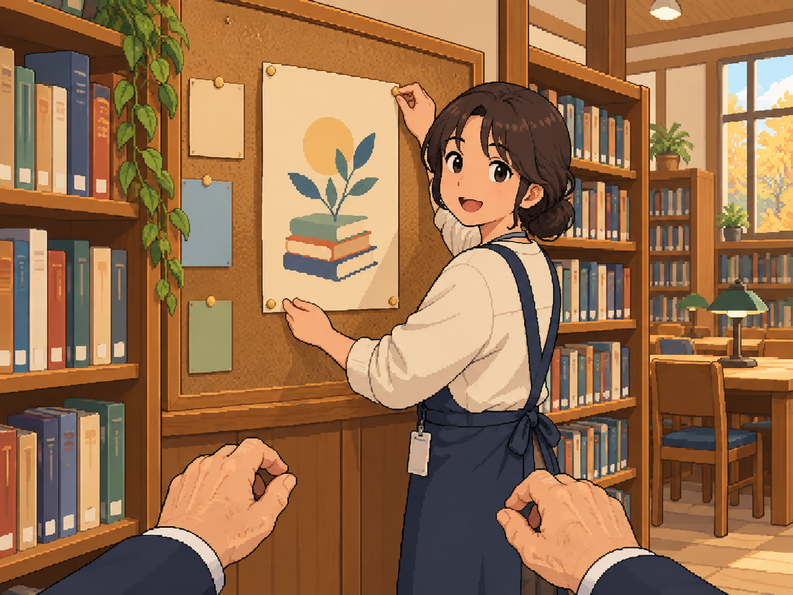

# 사용자 요청 수정본 2장 — 2026-11-03

분류 검토 중 사용자가 ‘수정해줘’라고 요청한 두 그림을 내장 image_gen으로 편집·생성했다.
사용자가 두 수정본 확인 후 **앱 적용을 요청해 작업 브랜치의 기존 사건 이미지 경로에 반영**했다.
승인 그룹 대표 샘플 3장이나 M 제작 배정 완료로 확대해 세지 않는다.
수정 전 앱 원본은 [originals](originals)에 보존했고, 새 원본 해상도를 그대로 적용했다.

## 예술고 첫 학기 — path_hap_09

변경: 밝은 낮 창을 어두운 밤 창으로, 실내를 따뜻한 작업등으로 조명했다.
옆자리 연습생에게 청소년 교복 단서를 추가했고, 기존 1인칭 그림 연습 구도와 도트풍을 유지했다.
읽을 수 있는 시각 숫자나 글자는 넣지 않았다.

## 마지막 강의 — path_int_10

변경: 대학 강단·청중을 도서관 책장·게시판·포스터를 붙이는 사서로 교체했다.
사서는 주인공을 향해 말을 거는 자세이며, 주인공은 노년의 손만 보이는 1인칭이다.
강연을 이미 한 결과를 그리지 않았고 포스터·책등·명찰에 읽을 수 있는 글자를 넣지 않았다.

## 확인 범위와 후속

- 생성 결과를 직접 열어 사건 내용·시점·읽을 글자·주인공 얼굴 노출 여부를 확인했다.
- 두 PNG는 파일 무결성과 정확한 4:3 비율을 검사했다. 실제 크기·SHA-256은 [파일 검증](file_validation.json)에 있다.
- 이 파일은 1448×1086 생성 원본 해상도다. 두 사건의 앱 파일을 이 PNG로 교체하고 카탈로그 해상도·설명·manifest 해시·출처도 맞췄다. 확대/축소·자르기·팔레트 처리는 하지 않았다.
- [로컬 적용 기록](application_record.json)에 적용 경로·신규/기존 해시·원본 보관 위치를 남겼다.
- 적용 뒤 콘텐츠·이미지 검증 오류 0, 기존 ImageRoutingTest와 Debug 빌드를 통과했다. APK 안의 두 PNG도 수정본과 바이트 단위로 일치한다. [적용 검사 결과](application_checks.json)를 참조한다.
- 실제 세로 크롭 전수 확인·팀 의미 검토는 아직 남아 있다. 그림 전체가 맞는 것과 실제 앱에서 중요한 부분이 보이는 것은 별도로 확인해야 한다.
- [사용한 최종 프롬프트와 원본 경로](prompts_and_sources.json)를 함께 보관한다. CLI/API fallback은 사용하지 않았다.

이번 수정본은 사용자 요청에 따른 개별 편집이다. 전체 N/R/M 확정이나 전원 대량 제작 승인으로 확대하지 않는다.

## 앱 미리보기에서 확인하기

홈 → **디자인 미리보기** → **장면 고르기**에서 다음 항목을 선택한다.

- 9. 예술고 첫 학기
- 10. 마지막 강의

미리보기는 실제 사건과 같은 앱 파일을 읽는다. 필름 안에서는 전체 구도를 볼 수 있고,
**장면 전체화면 보기**에서는 실제 플레이와 같은 `SceneBackdrop`의 가운데 크롭으로 세로 화면을 채운다.
그림을 한 번 터치하거나 뒤로 가면 선택한 항목으로 돌아온다.

API 36 에뮬레이터에서 두 항목의 실제 렌더링을 직접 확인했다.
두 장 모두 파일이 표시되며 빈 배경으로 대체되지 않았다.
예술고의 전체화면에서는 붓을 든 오른손이 좌우 크롭으로 빠지고, 도서관은 사서의 오른쪽 외곽과 책장이 일부 잘린다.
이는 이미지 내용이 안 잘린다는 최종 승인이 아니라 **실제 잘림을 검토할 수 있게 한 상태**다.
두 사건의 모바일 크롭 최종 승인 상태는 계속 대기다.

검사 결과: 새 Debug/AndroidTest 빌드 통과, Android 미리보기 검사 **2개 통과**.
10개 전체 이미지의 디코딩·다음/이전·메뉴·초기화·나가기·전체화면/터치 복귀와 320×400dp·글꼴 2배의 조작 접근을 확인했다.
작은 화면 검사는 아직 생성되지 않은 LazyColumn 안내문을 먼저 찾아 스크롤하게 보완한 뒤 두 검사 모두 다시 실행해 통과했다.
[최종 미리보기 검사 기록](scene_preview_checks.json)을 참조한다.

로컬 캡처:

- `output/followup-20261103/image-sample-9.png`, `image-sample-10.png`
- `output/followup-20261103/applied-scene-9-fullscreen.png`, `applied-scene-10-fullscreen.png`
