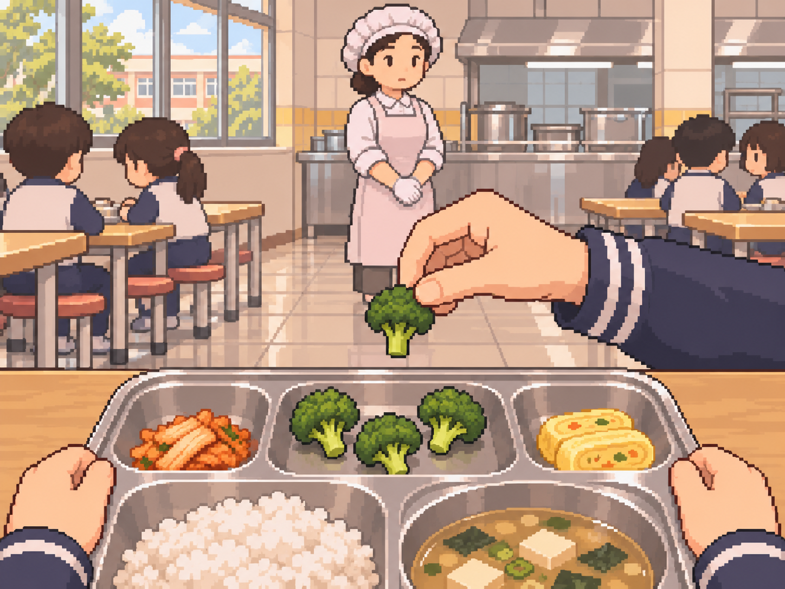

# 정원률 공통 샘플 제출 — 2026-11-03

PR #51 `dc7e6e9a3939e807bb6c182c76b0bb426a9f62da`에서 지정한 신규 공통 샘플 2장을 제작했다.
기존 도서관 `path_int_10`을 포함한 3종 검토용이며 배정 67장 안에 포함된다.
추가 제작 67장 중 이번 2장은 PNG 제출, 나머지 65장은 공통 샘플 검토 후 제작 대상이다. 승인 완료로 세지 않는다.

| 항목 | 그룹 / 사건 | 자체 검토 |
| --- | --- | --- |
| 급식 | grp_wr_path_hea_01 / path_hea_01 | 기존 브로콜리 세 송이 + 추가하는 손의 한 송이를 구분, 중앙에 영양사·트레이·추가 동작, 먹기 전 상태 |
| 첫 월급 | grp_shared_salary_deposit / adult_015·adult_080 | 집 목재 책상·저녁·나이 강조 없는 성인 손, 무문자 입금 아이콘, 지출 결과 없음 |

두 PNG는 내장 image_gen으로 새로 생성한 1448×1086 원본이며 후처리하지 않았다. 경로·해시·프롬프트·고정 명세는 [manifest.json](manifest.json)에 있다.
앱의 **디자인 미리보기 13·14번**에서 원본과 SceneBackdrop 중앙 크롭을 검토할 수 있다.
아직 사건 라우팅/중앙 카탈로그를 최종 교체하지 않았다. 샘플 검토 뒤 김선한·김재겸 통합 순서로 연결한다.

신기훈 의미, 김재겸 실제 크롭, 정원률 화풍·물체 검토가 필요하다. 자체 검토 통과를 팀 최종 승인으로 대신하지 않는다.
