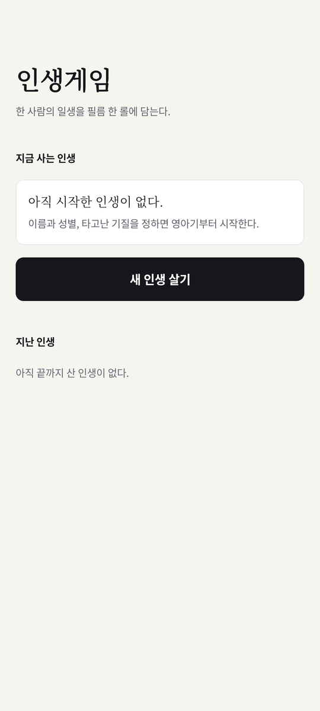
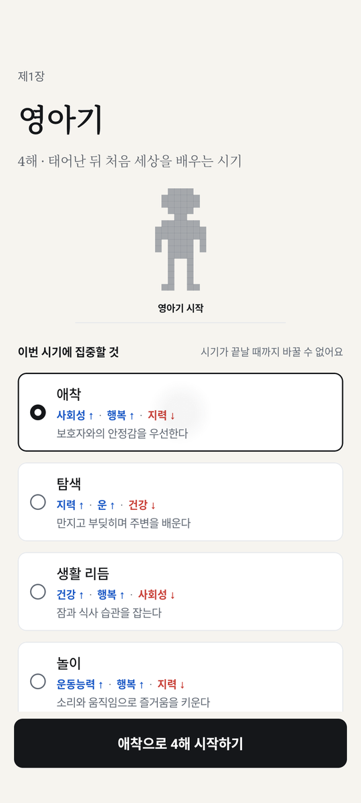
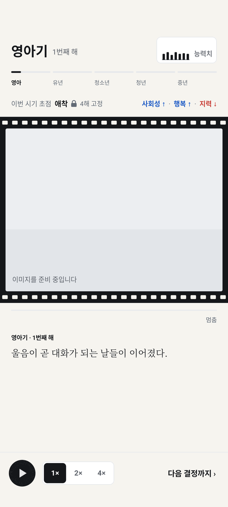
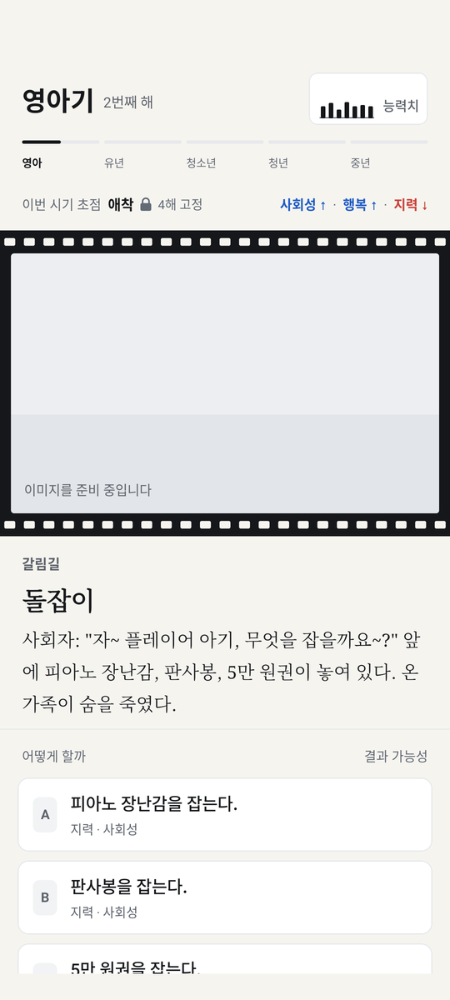
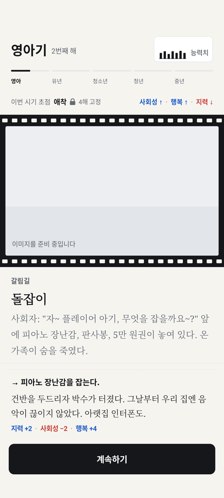

# 7주차 프론트엔드 제출 — 김재겸

- 브랜치: `feat/week7-frontend-jaegyeom`
- 기준: PR #20(백엔드 v4 엔진) 위에 PR #27(시나리오, #26 DB·QA 포함)을 합친 상태에서 작업했다.
  - 프론트 화면은 #20의 `PeriodGameSession`과 #26·#27의 `periods/focuses/events` 데이터를 써야 실제로 돌아가기 때문이다.
  - 세 PR이 main에 들어가면 이 PR의 차이에는 프론트 파일만 남는다.
  - 권장 merge 순서: #26 → #27 → #20 → 이 PR

## 화면 흐름

홈 → 프로필 만들기(이름 · 성별 · 타고난 기질) → 장 표지(시기 초점 고르기) → 자동 진행 → 결정 · 돌발 → 결과 → 다음 해 / 다음 장 표지 → 끝 기록 → 홈

| 홈 | 장 표지 · 초점 | 자동 진행 | 결정 · 돌발 | 결과 |
|---|---|---|---|---|
|  |  |  |  |  |

캡처는 에뮬레이터(Pixel 6a, API 35)에서 `Week7FlowSmokeTest`가 실제 앱을 조작하며 찍었다. 도트 이미지 파일은 아직 없어서 필름 안에는 자리 표시 그림이 보인다.

## 처리한 요구사항

| ID | 내용 | 위치 |
|---|---|---|
| R-110 | 앱 첫 화면 = 홈. 진행 중인 인생 카드, 이어하기 / 새 인생 살기, 지난 인생 목록 | `HomeScreen.kt` |
| R-111 | 진행 중인 인생이 있을 때 새 인생을 누르면 덮어쓰기 확인 | `HomeScreen.kt` |
| R-70 | 프로필 만들기에 성별(남 · 여). 남자는 시작 플래그 `military_service_required`를 받아 청년기 입영 통지서(adult_071)가 나온다 | `CharacterSelectScreen.kt`, `LifeGameViewModel.startNewLife` |
| — | 타고난 기질 3개를 `characters.sample.json`과 연결 (시작 능력치 · 플래그). 기존 "아기 1~3" 미연결 문제 해결 | `PeriodPlayUi.parseStarters` |
| R-10, R-11, R-12 | 장 표지에서 시기 초점 5개 중 하나를 고른다. 오르는 능력치(파랑) / 내리는 능력치(빨강) 미리 보기, "시기가 끝날 때까지 바꿀 수 없어요" | `ChapterFocusScreen.kt` |
| R-01 | 나이 대신 "시기 · N번째 해"와 시기 진행 막대 5칸 | `PeriodChrome.PeriodHeader` |
| R-20, R-21, R-22 | 자동 진행(1배속 1해 3초), 일시정지, 1× / 2× / 4×, "다음 결정까지". 결정 · 장 표지가 오면 멈춘다 | `AutoProgressScreen.kt` |
| R-23 | 해 넘김 = 지지직(배속에 맞춰 짧아짐). 모든 돌발 = 왜곡(배속과 상관없이 0.68초) → 팝업. 갈림길은 팝업 없이 바로 | `AutoProgressScreen.kt`, `DecisionScreen.kt` |
| R-40, R-43 | 선택지 아래에 숫자 대신 "가능성 낮음 / 반반쯤 / 높음 / 매우 높음 · 핵심 능력치". 결과가 하나뿐인 선택지는 영향받는 능력치만 | `PeriodPlayUi.hint` |
| R-44 | 숨은 결과의 문장 · 확률은 화면 상태에 들어가지 않는다 (단위 테스트 + 화면 테스트로 확인) | `buildDecisionUi` |
| R-100 | 3인칭 장면(`sceneImageId`) · 1인칭 장면(`povImageId`)을 필름에 연결. 파일이 없으면 4:3 자리 표시. 도트가 흐려지지 않게 확대할 때 보간하지 않음(nearest, `FilterQuality.None`) | `FilmStrip.kt` |
| — | `{name}` / `{nameCall}`을 결정 · 결과 · 초점 기록 문장에서도 치환 | `PlayerName.kt` |

## 수정 · 추가한 파일

- 신규 화면: `ui/screens/HomeScreen.kt`, `ChapterFocusScreen.kt`, `AutoProgressScreen.kt`, `DecisionScreen.kt`, `RunEndScreen.kt`
- 신규 공용: `ui/PeriodPlayUi.kt` (화면 상태 · 가능성 계산 · 매핑), `ui/components/PeriodChrome.kt` (헤더 · 초점 줄 · 버튼 · 능력치 시트), `ui/components/FilmTransitions.kt` (지지직 · 왜곡 타이밍)
- 수정: `ui/LifeGameApp.kt` (홈 → 프로필 → 플레이), `ui/LifeGameViewModel.kt` (v4 진행 함수 추가), `ui/PlayerName.kt`, `ui/screens/CharacterSelectScreen.kt`, `ui/components/FilmStrip.kt`, `ui/components/LifeHeader.kt` (능력치 버튼 재사용)
- 삭제: `ui/screens/StartScreen.kt` (홈으로 대체), `androidTest/.../Week6GameplaySmokeTest.kt` (옛 흐름 → `Week7FlowSmokeTest`로 교체)
- 테스트: `test/.../ui/PeriodPlayUiTest.kt` (12개), `test/.../ui/PeriodPlayFlowTest.kt` (실제 assets로 시작부터 끝까지), `androidTest/.../ui/Week7FlowSmokeTest.kt`

## 검증

- [x] `gradlew.bat test` — BUILD SUCCESSFUL, Debug 89 + Release 89, 실패 0
- [x] `gradlew.bat assembleDebug` — BUILD SUCCESSFUL
- [x] `gradlew.bat connectedDebugAndroidTest` (Pixel 6a API 35) — 12개 통과 (`Week6UiTest` 11 + `Week7FlowSmokeTest` 1)
- [x] `python scripts/validate_content.py` — PASS
- [x] `PeriodPlayFlowTest`: 실제 periods · focuses · events, 고정 seed 3개로 한 판 끝까지 진행했다. 모든 결정 화면에서 아래가 없는 것을 확인했다.
  - `%` (숫자 확률)
  - `{name` (이름 자리 표시)
  - 숨은 결과 문장
- [x] `Week7FlowSmokeTest`: 홈 → 새 인생 → 프로필(남 · 우렁찬 아기) → 장 표지 → 자동 진행(일시정지 · 배속 · 기록 확인) → 결정 화면 → 선택 → 결과까지 실제 앱으로 이동. 화면 전체에 `%`, `{name`이 0개

## 남은 문제 · 다음 담당

1. **앱을 껐다 켠 뒤 이어하기는 아직 안 된다.** 지금은 앱을 켜 둔 동안만 이어진다.
   - `PeriodRunState` 저장 · 복구 API가 필요하다(8주차 백엔드).
   - API가 나오면 `LifeGameViewModel`의 v4 부분에서 해마다 저장하고 홈에서 복원하도록 붙인다.
   - 옛 흐름의 저장 코드(`startNewGame` / `continueGame` 등)는 #20 것이라 지우지 않고 남겨 두었다.
2. **가능성 계산이 엔진 식을 복사해 쓴다** (`effectiveChance`).
   - 엔진(`PendingDecision` 또는 `DecisionChoicePreview`)이 미리보기용 가능성 값을 주면 프론트 계산을 지운다.
   - 같은 이유로 파서가 `primary`를 버려서, 지금은 "숨지 않은 첫 결과 = 대표 결과"로 본다. 데이터상 항상 첫 번째라 맞지만 엔진에서 받는 게 안전하다.
3. **엔진은 일반 돌발에 `TransitionCue.NOISE`를 준다.**
   - v4 규칙은 "모든 돌발 = 왜곡"이라, 프론트는 결정 종류(갈림길이 아니면 왜곡)로 연출을 정한다.
   - 엔진 값을 규칙에 맞추면 그 값을 쓰도록 바꾼다.
4. **아직 없는 화면:** 도트 캐릭터 그림(지금은 자리 표시 실루엣), 주마등 · 예상 미래 모습 · 인생 기록 서류.
   - 끝나면 지금은 임시 기록 화면(`RunEndScreen`)이 나온다. 8주차 프론트 작업이다.
5. **도트 이미지 파일은 `assets/images/`에 넣으면 바로 보인다.** 파일 이름은 `image_ids.sample.json`의 `fileName`을 따른다(UI/UX 산출물).
